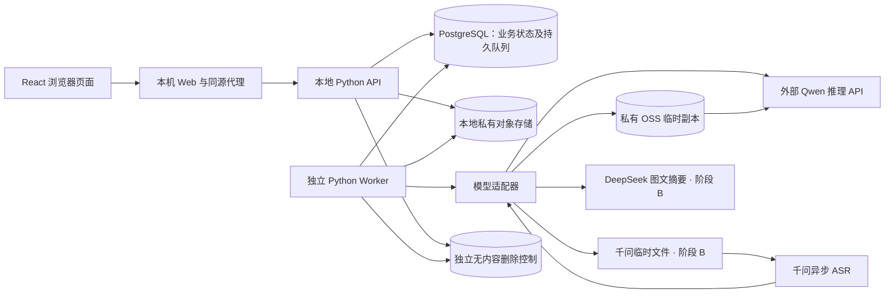

# Video Summary App 架构与详细设计

本文描述现行系统及设计边界。产品行为见 [PRD](PRD.md)，正式实例与维护入口见[本机运维](../deploy/README.md)。

## 1. 边界和决策状态

| 事项 | 状态 | 依据或处理 |
| --- | --- | --- |
| 模块化应用、持久队列、独立 Worker | 已批准 | [ADR-001](adr/ADR-001-modular-app-queue-worker.md) |
| 因普通用户活动任务或额度受阻时有限越过队首 | 已批准 | [ADR-002](adr/ADR-002-conditional-bypass.md)；原排序键仍有效 |
| 评测资料反向关联并随源任务删除 | 已批准 | [ADR-003](adr/ADR-003-linked-evaluation-cleanup.md) |
| 本地 API、数据库、队列、媒体、结果与日志 | 已采用 | 应用保留无内容的软件重建资料。历史副本按 [ADR-005](adr/ADR-005-cr-001-deletion-troubleshooting.md) 核实和处置。外部服务用于千问推理和大视频的临时 OSS 传输。 |
| TypeScript + React + Vite、Qwen3.8-Omni-Flash | 已部署 | 实际短视频内联和长视频 OSS 路径均有成功样本 |
| DeepSeek-V4.1-Flash 与迁移 012 | 已部署并启用 | B-5 两条真实素材及 B-6 SSE 已隔离验收。正式实例账本为 001～014，DeepSeek 常驻可选，Qwen 仍为默认。 |
| Python API/Worker、PostgreSQL 17、私有 RustFS 1.0.4 | 已部署 | ADR-004；当前运行镜像 ID 见经核对的 014 交付清单 |
| PostgreSQL 持久队列、同源静态前端、Docker Compose | 已批准首轮实施默认 | ADR-004；保留配置和实测后调整空间 |
| 输入容器为 MP4/MOV；视频 H.264/AVC，音轨若存在为 AAC/MP3 | 产品负责人于 2026-10-29 批准收敛，保持 2h/2GB；WebM 已排除 | PRD §3、AC-03 |
| URL 仅限 HTTPS Bilibili BV 播放页 | Stage C 014 已开放 | 2026-11-26 开放新导入，实际验证范围见[测试计划](E2E_TEST_PLAN.md#stage-c-014-正式验证记录)。 |

本机运行环境为 Windows 和 Docker Desktop。MVP 接收本地文件或合法 URL，单视频不超过 2 小时及 2 GB，容器及编码白名单以 [PRD §3](PRD.md) 为准。旧规划介质仍按历史副本规则核实。

## 2. 运行单元与职责

API 和 Worker 是两个独立运行单元，业务模块可保留在同一代码库；不预先拆为多个微服务，也不增加独立 Broker。Web 容器提供前端静态资源，并同源转发 API 请求。数据库是任务、额度、租约、删除和审计元数据的唯一权威；媒体内容放私有对象存储。对象存储不是公开文件服务器。

| 模块 | 对外职责与边界 |
| --- | --- |
| 身份与内容权限 | 注册、登录、退出、密码哈希、服务端会话、当前角色与逐请求任务归属校验。USER 和 ADMIN 从个人入口读本人内容，跨用户拒绝。 |
| 输入 | 接收本地上传或导入 URL；流式暂存、大小/时长/容器/codec/可解码性校验和授权确认；校验通过才创建可排队任务。 |
| 任务与额度 | 状态转换、普通用户最多一次机会及六小时恢复、实际开始扣一次、按最终分类退款、重试窗口/冷却/累计上限。 |
| 调度与 Worker | 按已批准排序和有限越过条件领取；租约、心跳、失联恢复、媒体预处理、模型调用、融合和输出校验。 |
| 结果与评测 | 内部 1.0 结果校验、中英文摘要、章节及 Markdown 下载；登记评测资料与源任务的可反向查找关联。 |
| 删除与审计 | 栅栏、资产登记、逐项清理验证、受控退避/限频、部署者可发现信号及审计式诊断/再推进、最小审计；历史副本过渡治理。 |
| 管理员元数据 | 独立工作台返回白名单字段，按 Task ID 字面搜索或精确匹配及分页。排障授权只保留退役接口和必要历史清退。 |

## 3. 核心数据与状态（设计默认）

PostgreSQL 是账户、会话、任务、额度、尝试、资产、审计及删除作业的权威状态。数据带有任务归属、UTC 时间和保留期限。001～014 保持冻结，010 的请求表及旧同意数据只作历史关闭、审计和清退，011 保留清理结构。媒体日志只记录必要元数据及受控定位。

用户界面只展示 `Queued`、`Processing`、`Completed`、`Failed`、`Cancelled`。内部可有校验、待重试、清理中等状态，但它们不得扩展用户可见状态。已完成或已取消任务不得被迟到 Worker、取消或模型响应改写；失败任务仅能通过已接受的重试重新排队；删除栅栏优先于所有产生新内容的动作。`SUCCEEDED` 映射为 `Completed`。任务和资产、普通日志自任务创建起30天，删除审计自各事件时间起90天；未完成作业留必要控制，不冒充成功。历史副本过渡期仍遵守原删除后30天义务，实际处置先批准，不新增内容备份。

| 内部状态转换 | 触发和必须同时保持的不变量 |
| --- | --- |
| 校验通过 → Queued | 记录 UTC 排序键；不扣处理机会。校验失败不入队。 |
| Queued → Processing | 持久领取、租约代次、活动名额、开始时间和首次扣额在同一权威事务内提交。 |
| Queued → Cancelled | 移出可领取集合；不扣额。 |
| Processing → Completed | 当前租约代次有效、未取消/删除、JSON 校验通过且结果资产已登记。 |
| Processing → Failed / Cancelled | 记录最终分类；符合退款条件且有未返还扣额才退款；取消不退款。 |
| Failed → Queued | 仅接受符合滚动窗口、冷却和累计上限的重试；同一任务不再次扣额。 |
| 任意非删除状态 → 删除中 → 清理完成 | 首先设置删除栅栏及访问拒绝；每项资产完成清理后才报告对应完成状态。 |

接口覆盖注册、会话、输入、本人任务和内容、取消、重试及删除。管理员元数据独立读取，历史内容授权 API 已退役，页面反馈仅取公共邮箱配置。详细状态码、搜索和角色边界见 [内容权限与管理接口](#内容权限与管理接口)。

## 4. 输入、模型与输出流程

1. API 校验会话与导入授权，将本地上传或独立下载器返回的单 P 完整音视频暂存。两种方式均验证容器、编码、时长及可解码性。
2. 通过校验并存入私有 RustFS 后才创建任务。Web 等待 API 确认创建，随后显示「导入成功」。上传进度和任务处理进度分别展示。
3. Worker 按租约领取任务。正式实例调用千问 AI 按量端点的 `qwen3.8-omni-flash`，使用 OpenAI 兼容流式接口。原文件不超过 7,499,988 字节时走 Base64 内联。更大的文件整份上传至专用私有 OSS 桶，Worker 提供有效期约 15 分钟的 HTTPS 签名读取链接。两条路径均交付视频画面和音轨。
4. OSS 临时对象写入清理账本，任务结束后尝试立即删除并确认，未完成项由 Worker 恢复处理。桶须保持私有、阻止公共访问、从未启用版本控制，并对 `vsa-qwen/` 启用 1 天到期删除规则作为兜底。
5. Worker 读取文本流和返回的用量，校验中英文结果、字段和时间戳后发布。下载复用读取时对内部 1.0 文档与展示字段的校验，在本人下载路由把已保存的摘要和章节转成 UTF-8 Markdown，无须改写旧结果。适配器一次调用的等待预算为 600 秒，调用失败后由用户按重试规则决定是否再次处理。原始用户 URL、账号、任务归属和本地路径排除在模型请求之外。

模型和 OSS 凭据从仓库根 `.env` 传给正式 Worker。可运行配置及计费边界见[千问与 OSS 操作指南](guides/QWEN_OSS.md)。

### DeepSeek 处理路径

导入 API 在接收媒体前校验模型。本地上传使用 `X-Video-Model`，Bilibili 导入使用 `model`。任务创建事务持久化 `tasks.requested_model`。迁移 012 将旧任务默认设为 `qwen3.8-omni-flash`，并为 `model_calls` 增加 `deepseek_phase` 和 `asr_provider_task_id`。Worker 按固定值选择处理分支。

1. **准备证据。** 在任务工作区用 FFmpeg 提取首视频轨最多 12 张 JPEG（每张最多 192 KiB），保留原始 PTS。首音轨压缩为 AAC-LC/M4A（16 kHz 单声道、目标 48 kb/s）。重采样后按 AAC 帧长分组，仅修正导致编码封包时间不递增的时间戳，保留音频样本及源轨偏移。抽样可能漏掉长视频中未覆盖的视觉细节。
2. **转写或纯画面。** 有可用音轨时通过千问免费临时上传，以 `oss://` 及 `X-DashScope-Async`、`X-DashScope-OssResourceResolve` 提交一次 `qwen-audio-3.1-asr-flash-filetrans`。轮询原任务并从受信 HTTPS 端点读取结果，将句级时间映射回源时间轴。无音轨、全轨峰值和 RMS 同时达到近数字静音判据（≤ −85 和 ≤ −95 dBFS），或 ASR 明确无词（含成功空转写）时，使用纯画面。ASR 传输、鉴权、限流、超时和协议等故障按相应失败分类处理。
3. **图文摘要。** `deepseek-v4.1-flash` 接收转写与关键帧，使用开启思考的 Chat Completions 和 JSON Object，沿用网关默认思考力度。所有视频时长的摘要响应均使用 SSE。Worker 丢弃思考片段，仅拼接正文，并在收到结束标记后校验并发布。两种语言各自产出详细摘要和有证据的章节。纯画面要求模型以有效 `frame_id` 引用章节及关键事件，由应用确定性映射回帧 PTS，在双语摘要附无可用语音说明。
4. **预算与发布。** 思考和最终回答共享 `max_tokens`。不足 15 分钟为 16,384，15 至不足 60 分钟为 32,768，60–120 分钟为 49,152。转写 512 KiB、摘要请求和流式正文各 4 MiB、SSE 总数据 32 MiB，以及 ASR 的 600 秒和摘要的 `DEEPSEEK_SUMMARY_TIMEOUT_SECONDS`（默认及上限 3600 秒）为独立应用预算。摘要连接和发送保持 8 秒套接字超时，Worker 与 HTTP 读取共用摘要截止时间，每秒核对取消、门禁和租约。调用结果未知时禁止自动重发。只有供应商明确返回 `finish_reason=length` 才识别为 `MODEL_OUTPUT_TRUNCATED`，保留合法用量及请求 ID。其他无效结果按脱敏结构诊断并拒绝发布。思考正文不存储。发布复核租约和双语契约，保持内部 1.0 兼容字段，页面和 Markdown 只展示摘要与章节。

应用工作区与派生文件按原规则清理。历史自有 OSS 音轨沿用 `ASR_AUDIO_TRANSFER` 补偿清理。新临时音轨按千问声明 48 小时到期，应用不登记为已确认远端物理删除。供应商处理副本的保留独立于链接有效期。正式运维与兼容回退见[部署指南](../deploy/README.md#stage-c-014-正式运维)，B-5 和 B-6 的实测样本与边界见[测试计划](E2E_TEST_PLAN.md#阶段-b-验证状态)。

## 5. 调度、租约、额度与重试（已批准首轮默认，待测试）

同一数据库事务内，调度者按校验后的 `(submitted_at_utc, user_id, task_id)` 查找最早可运行任务；仅当更早任务因所属普通用户已有活动任务、未扣过机会且额度不足，或两者同时成立而受阻时，才可越过。遇到其他阻塞停止扫描。每次领取从原顺序重扫，恢复资格的任务依原顺序领取。全局名额不足时不越过；同一用户保序；管理员无优先级。领取同时记录原排序键、阻塞/越过原因、开始时间、活动名额和唯一扣额事件。事务加唯一约束保证两个 Worker 不重复领取或扣额。全局并发值和排队容量保持可配置，依据 ≤5 人同时上传、10–30 人使用的测量确定，不预填未经批准的数字。

每个有效领取持有带代次的租约；心跳续约，过期后的新领取提高 `lease_generation`。Worker 写状态、结果或资产前必须用当前代次、未取消且未删除的条件事务校验；旧 Worker 恢复后不得写入。当前正式 Compose 配置为 30 秒租约、2 秒心跳。远端请求结果未知时避免立即并发重发，以免重复外部费用。

额度通过持久事件流水与余额事务控制：队列取消不扣；首次实际开始仅扣一次；处理中取消已扣不退；同任务重试不再扣。内部错误、模型超时/限流/不可用及未知错误按 [PRD §4](PRD.md) 退款，且只可返还尚未返还的已扣机会，普通用户余额封顶 1。新注册显式以 1 写入。已有余额在持锁的额度处理事务中按 1 封顶，已有零余额的恢复锚点沿用。管理元数据按同一上限返回余额，不回填历史流水，不改动冻结迁移。Worker 崩溃导致内部失败同样适用；外部 Token 费用独立记账。失败、取消、退款竞态以最终状态和可审计原因决定。已接受的重试受滚动 5 分钟、第 5 次触发冷却、累计 20 次接受上限及 1/5/15/30 分钟阶梯；重复请求键不重复计数。冷却/上限拒绝不启动处理。页面额度提示为「同一任务重试不额外扣机会」。

## 6. 删除、内容权限与历史恢复

删除前验证会话、CSRF和所有权，持久化独立删除意图并在权威事务设置删除栅栏、失效租约代次/重试，同时关闭和清退历史授权记录。接受后列表移除并拒绝读取，返回接受不表示内容已清除。外部存储和数据库并非原子事务，保留独立意图、启动重放和故障补偿。

media_assets 和 evaluation_links 覆盖原片、音频、帧/片段、SQL结果/导出、临时文件、缓存、关联评测副本/标注/输出/失败案例。逐项幂等清理，实际验证正文、对象、目录消失及受控生产停止后才标成功；代次失效不单独证明任意线程或外部模型已停止。删除依据可信归属登记，不能整体清空共享 bucket/目录，不能把权限错误/超时当不存在。

移除删除记录、人工清理和备份核验产品页面/专用API，保留后台作业和诊断。临时故障退避限频，持续故障留部署者实际可发现的持久信号；危险路径/归属不明停止自动删除。受控诊断和再推进有审计，按已批R-03/R-04采用四态、单job_version、全局清理EX、三维护入口及最低故障发现；WP04 已冻结清理字段并验证，持续故障留待受控处置。

本人内容服务与管理元数据分离。内容访问绑定当前会话、数据库角色和任务所有权，视频传输在 I/O 边界复核权限及删除控制。管理员后台只显示任务元数据，已退役的排障 UUID、目的授权和任何旧请求都不能产生内容访问权限。

删除审计按各事件时间90天到期清理；完成后收缩资产位置/任务详情/凭证，仅最小无内容审计及必要控制。未完成作业留必要执行控制直到完成或授权解决，不因此延长内容保留承诺；其他审计期限另行设计，不默认90天。

不主动创建内容备份，部署避免新增含内容整库备份/系统快照，可留无内容的软件重建资料。历史副本先清点隔离核实，获专项批准再清理；处置完成前保留 BACKUP 清理及恢复防复活。正常启动依赖的 deletion_control/共享卷不能随页面删除。获准恢复先隔离服务、重放删除控制、终止旧会话及新旧授权，再验证后开放；过旧/证据不足快照不得绕过检查。

完成验收覆盖应用实际受控SQL正文、对象、文件/目录及内容资产；不等于数据库MVCC/WAL或存储历史字节/SSD安全擦除，不保证清除下载和供应商副本。软件重建不等于原片、摘要、账户及元数据可恢复。

### 内容权限与管理接口

- 有效 USER/ADMIN 仅正常 owner 路径读取本人摘要、双语 Markdown、视频与 Range；其他用户一律拒绝。实时数据库角色必须与发起时 Principal.role 一致，角色变化使在途操作拒绝，重新获取当前身份后可按新身份访问本人。摘要最终复核、视频各 I/O 前后复核、独立删除控制保留。已配置journal的identity运行中丢失/损坏/失配时须复用现有identity_ready拒读503，不重建控制；视频停止后续块。
- 管理元数据页面和 /admin/tasks 永不返回内容，含本人任务；无内容预览入口。白名单包括任务及用户 ID、状态和时间、错误分类与代码、重试记录、额度和模型调用统计。模型调用统计仅含状态、版本、用量、估算费用、错误分类和时间。
- `GET /admin/tasks?task_id=...&limit=20&offset=0` 返回任务数组。省略或空串为全部列表；标准 UUID 不区分大小写精确匹配；其他任意文本按 Task ID 字面包含匹配；不限制最小字符数、字符集或36字符输入长度，非匹配文本返回空列表；%/_/反斜线不作为通配符。`limit` 为 1～100（默认 50），`offset` 为 0～10000（默认 0），稳定 submitted_at,user_id,id 顺序。只后台全局查询，不搜索正文或文件名；不保留 User ID 筛选（旧 user_id 参数422）。查询事务2秒 statement_timeout；搜索每当前管理员60次/60秒、来源300次/60秒，持久限速独立于登录计数。超限429/Retry-After，超时503，不返回原始错误。
- CR-001 support 请求所有接口为墓碑410，未认证401、错误角色403，mutation保留CSRF；旧consent/purpose保持410。内部request_id/purpose不得转入owner作为跨用户凭证。
- `GET /config/public` 返回 `support_email`（字符串或 `null`）、`default_model` 和 `available_models`。反馈邮箱取运行时 `SUPPORT_EMAIL`，未配置或非法时隐藏。模型列表由部署开关决定，默认始终为 Qwen。接口不回显凭据或其他配置。

## 7. 运行与验证边界

正式实例 `vsa-local` 运行在 Windows Docker Desktop 的 Linux 容器中。Web 仅绑定 `127.0.0.1:58080`，API、Worker、PostgreSQL 和 RustFS 在 Docker 私网。五个原有卷分别用于数据库、对象、删除控制、导入暂存和处理工作区。Stage C 另用 `bilibili-api` 和 `bilibili-egress` 两个套接字卷以及 `bilibili-work` 下载工作卷。014 交付包提供镜像、Compose 和恢复所需的无内容软件资料。正式配置、更新入口和状态检查见[本机运维](../deploy/README.md)。

历史 S3-12 部署已验证隔离重建、镜像升级、容器恢复、业务流程和卷连续性，当时的正式实例通过负责人长视频验收。014 的开门前离线冒烟和实际开放检查见[测试计划](E2E_TEST_PLAN.md#stage-c-014-正式验证记录)。应用的 2 GB/2 小时接收上限与样本实测分开记录。并发、质量、时延目标和完整边界测试见[端到端测试计划](E2E_TEST_PLAN.md)和[质量评估](testing/QUALITY_EVALUATION.md)。

负责人在本机网页决定真实素材及模型费用，自动回归使用合成素材和模型替身。千问服务端收到实际媒体；删除 OSS 临时副本只影响该对象。服务商日志和副本遵守各自平台规则。

## 8. 需求、设计与验证追踪

| 质量场景 | 需求或决策 | 设计位置 | 后续验证 |
| --- | --- | --- | --- |
| QA-01 成功任务 P90 | PRD §8、AC-12 | §7 | 记录环境、负载、样本及实际处理时长；未验证。 |
| QA-02 媒体与 URL | PRD §3、AC-03/21 | §4 | 白名单、边界、损坏、SSRF 与重定向。 |
| QA-03 排序和并发 | PRD §5、ADR-002 | §5 | 平手、越过、全局饱和与长期等待。 |
| QA-04 额度和恢复 | PRD §4、ADR-001 | §3/5 | 重复领取、崩溃、退款和取消竞态。 |
| QA-05 身份隔离 | PRD §2、AC-01/02/16/17 | §2/6 | 两种角色的本人内容与跨用户拒绝、元数据、字面搜索、旧 API 拒绝和续流。 |
| QA-06 删除与恢复 | PRD §7、ADR-003/005 | §3/6 | Worker竞争、重试/诊断、危险删除、最小审计、历史副本和获准恢复。 |
| QA-07 双语结果与下载 | PRD §6、AC-13～15 | §4 | 内部结构校验、Markdown 内容与格式、权限及失败路径。 |
| QA-08 质量基线 | PRD §9、QUALITY_EVALUATION | §7 | 15 个授权视频、单人标注、±5 秒初始容差。 |
| QA-09 诊断审计 | PRD §5/7、AC-18～20 | §3/5/6 | UTC、越过/退款/删除记录与 30/90 天清理。 |
| QA-10 本地/外部边界 | PRD §1/3、ADR-001 | §1/2/4/7 | 资产位置、外发字段、账号条款和入口审批。 |

## 9. 仍待验证或单独处理

| 事项 | 边界 |
| --- | --- |
| 容量与质量 | 正式长视频成功样本已确认。接近产品上限的组合、并发、P90 和大样本质量仍待实测。 |
| 历史副本 | 外部介质、自动快照和基础设施副本单独核实及审批。 |
| 阶段 B 实测边界 | B-6 覆盖一条近两小时视频。后续仍需核实供应商处理副本留存，并在各样本和负载条件下评估稳定性。正式部署和兼容回退状态见本机运维。 |
| 独立阶段 | Qwen 整视频改用平台临时存储仍暂停。Stage C 近两小时全流程与正式容量待验收。 |
| 本机状态检查 | Windows 定时巡检和桌面通知已停用。日常检查使用本机健康接口和受控维护入口。 |

## 10. 本机部署安全

Windows Docker Desktop 使用 Linux 容器。Web 仅绑定 IPv4 回环地址，API、Worker、PostgreSQL 17 和私有 RustFS 经项目私网通信。Web、API、Worker 以 UID 10001 运行。数据库、对象、独立删除控制、暂存及处理目录分别使用持久卷，普通服务无 Docker socket。

新部署验证目标为空且身份匹配，完整应用所选交付包的冻结 SQL（阶段 B 为 001～012，Stage C 为 001～014）后建立独立 journal 身份、producer-ready 和初始 CLOSED。一次性初始化、非 superuser 的维护 owner 和普通 runtime 使用独立凭据，初始化在写入前拒绝重复的解码密码。API/Worker 仅有运行所需的数据库和私有桶权限。runtime 无 DDL、角色切换和内容授权能力，历史 consent/support 仅保留关闭及清退权限。

可信 OPEN 才允许业务。状态缺失、损坏、未知、符号链接或与部署身份失配时拒绝；状态跨重启保留。只有实际数据库 owner 和匹配的控制身份可经维护 CLI 开关门。严格部署强制维护门禁，历史兼容模式限隔离回归。CLOSED 下 live 保留诊断，ready 和业务拒绝访问。API 在入口、事务提交、响应和续流检查门禁；Worker 在重放、领取、心跳、读写、清理及发布的检查点拒绝后续业务。保留资源释放和必要清退记录，已送达字节或已开始的单次系统调用无法追回。

严格模式离线检查、恢复和重放使用验证过的维护连接。OPEN 在重放提交后写入。控制失信时保持关闭并保留原控制，恢复时撤销旧会话和历史授权。实际操作见[本机运维](../deploy/README.md)，删除栅栏、物理锁和审计见[删除与维护设计](design/DELETION_OPERATIONS.md)。

## 11. 验证与退出

发布验证覆盖[端到端测试计划](E2E_TEST_PLAN.md)中的对应场景。记录实际通过、失败与未执行项，并在[本机运维](../deploy/README.md)记录已验收的部署状态。

## Stage C 下载边界

Bilibili 导入使用受限出口和私有对象存储。选择的材料类型通过 014 迁移固定为完整媒体、平台字幕或独立音轨。字幕清单保留原有 512 KiB 上限。首选轨与最多一条同语言备选轨共用 512 KiB 正文预算，读取允许原有的 1 字节溢出探测。字幕校验语言、源时间轴及覆盖。仅正文无效时尝试备选轨。独立 AAC 音轨须完整解码且无视频轨。平台要求字幕登录时可回退公开音轨，传输及出口规则错误直接上报。两种模型接收同样的文稿时间结构，未分析画面的结果注明限制。014 的 Qwen SSE 在读流时检查本地取消信号和截止时间，由 Worker 的定时心跳续租。租约失效、取消或到达绝对截止时间可以中断阻塞读取，发布事务仍复核租约、所有者和删除状态。失败诊断只记录流计数和到达时间，不保存片段正文。已校验的转写随任务保留，重试使用同一文稿，删除任务时回收。

独立 yt-dlp 容器使用 Docker 无网络模式。应用通过本地 Unix 套接字提交 BV/P，公网 HTTPS 通过独立出站服务的另一个 Unix 套接字和专用 `bilibili-public` Docker 网桥发出。版本固定、单作业、磁盘暂存与文件字节上限、连接目标允许名单、DNS 解析后公网地址校验及 TLS 校验共同约束下载。视觉选轨保持 MP4/H.264 白名单，移除 480p 上限，使用 HTTPS 分段读取以复用现有隧道的连接上限。导入经过现有媒体校验、对象保存和入队事务。取消、对象回收和 Worker 仍沿用既有控制。

导入采用同步网关请求。API 轻量路径限制 240 秒，视觉路径限制 900 秒，Web 在 915 秒兜底并向上游传播浏览器断线。独立下载器卷持有单作业锁并在启动时回收旧暂存，API 在校验后保存私有对象并入队。视觉 Worker 在任务工作区沿视频轨显示时间取样，通常每 6 秒，超过 1,000 点改为覆盖全视频轨的均匀取样。采样点选取该时刻显示的帧，保留末帧和尾组，空格补黑。音轨可超出视频轨，转写覆盖可用音轨。每张 1920×1080 JPEG 最多四帧，标签可含小数秒。Worker 按实际序列化字节和图片数分批，所有批次成功后才汇总与发布。DeepSeek 多批检验事实结构、来源及原片时间，完整事实进入统一双语汇总，超出最后画面时间的语音也直接提供给汇总。两种视觉流的 SSE 响应体上限均为 8 MiB（含事件分隔符），截断、无效结束或不完整响应不得发布。Qwen 视觉传输独立记录 TCP/TLS、请求体写入、等待响应头和读流，已写字节记本地套接字接受量。日志保留计数、时间和已知用量，不记录媒体、请求正文或事实正文。容量、阈值与未验边界见 [Stage C 容量](design/STAGE_C_LIMITS.md)。
