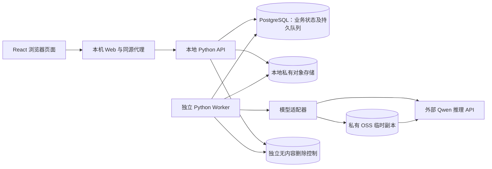

# Video Summary App 架构与详细设计

本设计采用 [CR-002](CR-002.md) 的内容权限。正式实例以 WP07-A 首次部署为基础，现运行 S3-12。ADR-001～004 及 ADR-005 保留批准历史。阶段进度见[实施计划](IMPLEMENTATION_PLAN.md#当前交付状态)。

## 1. 边界和决策状态

| 事项 | 状态 | 依据或处理 |
| --- | --- | --- |
| 模块化应用、持久队列、独立 Worker | 已批准 | [ADR-001](adr/ADR-001-modular-app-queue-worker.md) |
| 仅因同用户活动任务受阻时有限越过队首 | 已批准 | [ADR-002](adr/ADR-002-conditional-bypass.md)；原排序键仍有效 |
| 评测资料反向关联并随源任务删除 | 已批准 | [ADR-003](adr/ADR-003-linked-evaluation-cleanup.md) |
| 本地 API、数据库、队列、媒体/结果和日志；无新增内容备份 | CR-D09 已批准 | 历史副本按 CR-D10 治理。外部服务用于千问推理和大视频的临时 OSS 传输。 |
| TypeScript + React + Vite、Qwen3.8-Omni-Flash | 已部署 | 实际短视频内联和长视频 OSS 路径均有成功样本 |
| Python API/Worker、PostgreSQL 17、私有 RustFS 1.0.4 | 已部署 | ADR-004；运行镜像 ID 见 S3-12 交付清单 |
| PostgreSQL 持久队列、同源静态前端、Docker Compose | 已批准首轮实施默认 | ADR-004；保留配置和实测后调整空间 |
| 输入容器为 MP4/MOV；视频 H.264/AVC，音轨若存在为 AAC/MP3 | 产品负责人于 2026-10-29 批准收敛，保持 2h/2GB；WebM 已排除 | PRD §3、AC-03 |
| URL 仅限安全校验后的 HTTPS 直达媒体文件 | 已确认 MVP 产品范围 | PRD §1/§3；平台播放页面集成另行评估 |

本机运行环境为 Windows 和 Docker Desktop。MVP 接收本地文件或合法 URL，单视频不超过 2 小时及 2 GB，容器及编码白名单以 [PRD §3](PRD.md) 为准。旧规划介质仍按历史副本规则核实。

## 2. 运行单元与职责

API 和 Worker 是两个独立运行单元，业务模块可保留在同一代码库；不预先拆为多个微服务，也不增加独立 Broker。Web 容器提供前端静态资源，并同源转发 API 请求。数据库是任务、额度、租约、删除和审计元数据的唯一权威；媒体内容放私有对象存储。对象存储不是公开文件服务器。

| 模块 | 对外职责与边界 |
| --- | --- |
| 身份与内容权限 | 注册、登录、退出、密码哈希、服务端会话、当前角色与逐请求任务归属校验。USER 和 ADMIN 从个人入口读本人内容，跨用户拒绝。 |
| 输入 | 接收本地上传或导入 URL；流式暂存、大小/时长/容器/codec/可解码性校验和授权确认；校验通过才创建可排队任务。 |
| 任务与额度 | 状态转换、三次机会及六小时恢复、实际开始扣一次、按最终分类退款、重试窗口/冷却/累计上限。 |
| 调度与 Worker | 按已批准排序和唯一越过条件领取；租约、心跳、失联恢复、媒体预处理、模型调用、融合和输出校验。 |
| 结果与评测 | 固定 JSON Schema 1.0 校验、中英文结果、时间戳；登记评测资料与源任务的可反向查找关联。 |
| 删除与审计 | 栅栏、资产登记、逐项清理验证、受控退避/限频、部署者可发现信号及审计式诊断/再推进、最小审计；历史副本过渡治理。 |
| 管理员元数据 | 独立工作台返回白名单字段，按 Task ID 字面搜索或精确匹配及分页。排障授权只保留退役接口和必要历史清退。 |

## 3. 核心数据与状态（设计默认）

PostgreSQL 是账户、会话、任务、额度、尝试、资产、审计及删除作业的权威状态。数据带有任务归属、UTC 时间和保留期限。001～011 保持冻结，010 的请求表及旧同意数据只作历史关闭、审计和清退，011 保留清理结构。媒体日志只记录必要元数据及受控定位。

用户界面只展示 `Queued`、`Processing`、`Completed`、`Failed`、`Cancelled`。内部可有校验、待重试、清理中等状态，但它们不得扩展用户可见状态。已完成或已取消任务不得被迟到 Worker、取消或模型响应改写；失败任务仅能通过已接受的重试重新排队；删除栅栏优先于所有产生新内容的动作。`SUCCEEDED` 映射为 `Completed`。任务和资产、普通日志自任务创建起30天，删除审计自各事件时间起90天；未完成作业留必要控制，不冒充成功。历史副本过渡期仍遵守原删除后30天义务，实际处置先批准，不新增内容备份。

| 内部状态转换 | 触发和必须同时保持的不变量 |
| --- | --- |
| 校验通过 → Queued | 记录 UTC 排序键；不扣处理机会。校验失败不入队。 |
| Queued → Processing | 持久领取、租约代次、活动名额、开始时间和首次扣额在同一权威事务内提交。 |
| Queued → Cancelled | 移出可领取集合；不扣额。 |
| Processing → Completed | 当前租约代次有效、未取消/删除、JSON 校验通过且结果资产已登记。 |
| Processing → Failed / Cancelled | 记录最终分类；符合退款条件且有未返还扣额才退款；取消不退款。 |
| Failed → Queued | 仅接受符合滚动窗口、冷却和累计上限的重试；同一任务不再次扣额。 |
| 任意非删除状态 → 删除中 → 清理完成 | 首先设置删除栅栏及访问拒绝；每项资产完成清理后才报告对应完成状态。 |

接口覆盖注册、会话、输入、本人任务和内容、取消、重试及删除。管理员元数据独立读取，历史内容授权 API 已退役，页面反馈仅取公共邮箱配置。详细状态码、搜索和角色边界见 [CR-002](CR-002.md#权限及接口)。

## 4. 输入、模型与输出流程

1. API 校验会话与导入授权，将本地上传或安全校验后的 HTTPS 直达媒体暂存。HTTPS 导入检查解析地址和每次跳转，限制目标和下载字节。两种方式均验证容器、编码、时长及可解码性。
2. 通过校验并存入私有 RustFS 后才创建任务。Web 等待 API 确认创建，随后显示「导入成功」。上传进度和任务处理进度分别展示。
3. Worker 按租约领取任务。正式实例调用千问 AI 按量端点的 `qwen3.8-omni-flash`，使用 OpenAI 兼容流式接口。原文件不超过 7,499,988 字节时走 Base64 内联。更大的文件整份上传至专用私有 OSS 桶，Worker 提供有效期约 15 分钟的 HTTPS 签名读取链接。两条路径均交付视频画面和音轨。
4. OSS 临时对象写入清理账本，任务结束后尝试立即删除并确认，未完成项由 Worker 恢复处理。桶须保持私有、阻止公共访问、从未启用版本控制，并对 `vsa-qwen/` 启用 1 天到期删除规则作为兜底。
5. Worker 读取文本流和返回的用量，校验中英文结果、字段和时间戳后发布。适配器一次调用的等待预算为 600 秒，调用失败后由用户按重试规则决定是否再次处理。原始用户 URL、账号、任务归属和本地路径排除在模型请求之外。

模型和 OSS 凭据从仓库根 `.env` 传给正式 Worker。可运行配置及计费边界见[千问与 OSS 操作指南](S3_11_USER_GUIDE.md)。[S3-11 探针记录](archive/s3/S3_11_PREFLIGHT.md)保留早期协议和模型资料。

## 5. 调度、租约、额度与重试（已批准首轮默认，待测试）

同一数据库事务内，调度者按校验后的 `(submitted_at_utc, user_id, task_id)` 查找最早可运行任务；仅当更早任务的**唯一**阻塞原因是所属普通用户已有活动任务时，才可越过。全局名额不足时不越过；同一用户保序；管理员无优先级。领取同时记录原排序键、阻塞/越过原因、开始时间、活动名额和唯一扣额事件。事务加唯一约束保证两个 Worker 不重复领取或扣额。全局并发值和排队容量保持可配置，依据 ≤5 人同时上传、10–30 人使用的测量确定，不预填未经批准的数字。

每个有效领取持有带代次的租约；心跳续约，过期后的新领取提高 `lease_generation`。Worker 写状态、结果或资产前必须用当前代次、未取消且未删除的条件事务校验；旧 Worker 恢复后不得写入。当前正式 Compose 配置为 30 秒租约、2 秒心跳。远端请求结果未知时避免立即并发重发，以免重复外部费用。

额度通过持久事件流水与余额事务控制：队列取消不扣；首次实际开始仅扣一次；处理中取消已扣不退；同任务重试不再扣。内部错误、模型超时/限流/不可用及未知错误按 [PRD §4](PRD.md) 退款，且只可返还尚未返还的已扣机会，余额封顶 3。Worker 崩溃导致内部失败同样适用；外部 Token 费用独立记账。失败、取消、退款竞态以最终状态和可审计原因决定。已接受的重试受滚动 5 分钟、第 5 次触发冷却、累计 20 次接受上限及 1/5/15/30 分钟阶梯；重复请求键不重复计数。冷却/上限拒绝不启动处理。第 4 次及更晚模型超时重试仍不额外扣机会，UI 提示可能的 API 费用。

## 6. 删除、内容权限与历史恢复

删除前验证会话、CSRF和所有权，持久化独立删除意图并在权威事务设置删除栅栏、失效租约代次/重试，同时关闭和清退历史授权记录。接受后列表移除并拒绝读取，返回接受不表示内容已清除。外部存储和数据库并非原子事务，保留独立意图、启动重放和故障补偿。

media_assets 和 evaluation_links 覆盖原片、音频、帧/片段、SQL结果/导出、临时文件、缓存、关联评测副本/标注/输出/失败案例。逐项幂等清理，实际验证正文、对象、目录消失及受控生产停止后才标成功；代次失效不单独证明任意线程或外部模型已停止。删除依据可信归属登记，不能整体清空共享 bucket/目录，不能把权限错误/超时当不存在。

移除删除记录、人工清理和备份核验产品页面/专用API，保留后台作业和诊断。临时故障退避限频，持续故障留部署者实际可发现的持久信号；危险路径/归属不明停止自动删除。受控诊断和再推进有审计，按已批R-03/R-04采用四态、单job_version、全局清理EX、三维护入口及最低故障发现；WP04 已冻结清理字段并验证，持续故障留待受控处置。

本人内容服务与管理元数据分离。内容访问绑定当前会话、数据库角色和任务所有权，视频传输在 I/O 边界复核权限及删除控制。管理员后台只显示任务元数据，已退役的排障 UUID、目的授权和任何旧请求都不能产生内容访问权限。详细拒绝条件见 [CR-002](CR-002.md)。

删除审计按各事件时间90天到期清理；完成后收缩资产位置/任务详情/凭证，仅最小无内容审计及必要控制。未完成作业留必要执行控制直到完成或授权解决，不因此延长内容保留承诺；其他审计期限另行设计，不默认90天。

不主动创建内容备份，部署避免新增含内容整库备份/系统快照，可留无内容的软件重建资料。历史副本先清点隔离核实，获专项批准再清理；处置完成前保留 BACKUP 清理及恢复防复活。正常启动依赖的 deletion_control/共享卷不能随页面删除。获准恢复先隔离服务、重放删除控制、终止旧会话及新旧授权，再验证后开放；过旧/证据不足快照不得绕过检查。

完成验收覆盖应用实际受控SQL正文、对象、文件/目录及内容资产；不等于数据库MVCC/WAL或存储历史字节/SSD安全擦除，不保证清除下载和供应商副本。软件重建不等于原片、摘要、账户及元数据可恢复。

## 7. 运行与验证边界

正式实例 `vsa-local` 运行在 Windows Docker Desktop 的 Linux 容器中。Web 仅绑定 `127.0.0.1:58080`，API、Worker、PostgreSQL 和 RustFS 在 Docker 私网。五个独立卷分别用于数据库、对象、删除控制、导入暂存和处理工作区。S3-12 交付包提供镜像、Compose 和恢复所需的无内容软件资料。正式配置、更新入口和状态检查见[本机运维](../deploy/README.md)。

S3-12 已验证隔离重建、镜像升级、容器恢复、业务流程和卷连续性，正式实例已升级并通过负责人长视频验收。应用的 2 GB/2 小时接收上限与样本实测分开记录。并发、质量、时延目标和完整边界测试见[实施计划](IMPLEMENTATION_PLAN.md)和[质量评估](QUALITY_EVALUATION.md)。

负责人在本机网页决定真实素材及模型费用，自动回归使用合成素材和模型替身。千问服务端收到实际媒体；删除 OSS 临时副本只影响该对象。服务商日志和副本遵守各自平台规则。

## 8. 需求、设计与验证追踪

| 质量场景 | 需求或决策 | 设计位置 | 后续验证 |
| --- | --- | --- | --- |
| QA-01 成功任务 P90 | PRD §8、AC-12 | §7 | 记录环境、负载、样本及实际处理时长；未验证。 |
| QA-02 媒体与 URL | PRD §3、AC-03/21 | §4 | 白名单、边界、损坏、SSRF 与重定向。 |
| QA-03 排序和并发 | PRD §5、ADR-002 | §5 | 平手、越过、全局饱和与长期等待。 |
| QA-04 额度和恢复 | PRD §4、ADR-001 | §3/5 | 重复领取、崩溃、退款和取消竞态。 |
| QA-05 身份隔离 | PRD §2、AC-01/02/16/17、CR-002 | §2/6 | 两种角色的本人内容与跨用户拒绝、元数据、字面搜索、旧 API 拒绝和续流。 |
| QA-06 删除与恢复 | PRD §7、ADR-003/005、CR-D09～16 | §3/6 | Worker竞争、重试/诊断、危险删除、最小审计、历史副本和获准恢复。 |
| QA-07 双语 JSON | PRD §6、AC-13～15 | §4 | Schema、语言、时间顺序及失败路径。 |
| QA-08 质量基线 | PRD §9、QUALITY_EVALUATION | §7 | 15 个授权视频、单人标注、±5 秒初始容差。 |
| QA-09 诊断审计 | PRD §5/7、AC-18～20 | §3/5/6 | UTC、越过/退款/删除记录与 30/90 天清理。 |
| QA-10 本地/外部边界 | PRD §1/3、ADR-001 | §1/2/4/7 | 资产位置、外发字段、账号条款和入口审批。 |

## 9. 仍待验证或单独处理

| 事项 | 边界 |
| --- | --- |
| 容量与质量 | 正式长视频成功样本已确认。接近产品上限的组合、并发、P90 和大样本质量仍待实测。 |
| 历史副本 | 外部介质、自动快照和基础设施副本单独核实及审批。 |
| 模型故障诊断 | 脱敏失败诊断已在候选 Worker 复验，当前正式镜像沿用 S3-12 验收版。 |
| 本机状态检查 | Windows 定时巡检和桌面通知已停用。日常检查使用本机健康接口和受控维护入口。 |

## 10. WP01 设计与 WP07-A 部署交接

[WP01 共享契约](archive/cr/CR-WP01_CONTRACT.md)与[评审](archive/cr/CR-WP01_REVIEW_REPORT.md)保留 L1.0 历史设计。旧请求数据/API及旧部署切换方案归档。未被替代的删除、锁、恢复和保留规则见 [WP04 设计与验证](CR-WP01_DELETION_OPERATIONS.md)。

WP07-A 隔离验证覆盖持久门禁、初始化/维护/普通运行身份、非 root 应用及 Windows 故障巡检。可信 OPEN 才允许业务，关闭跨容器重启保持，控制身份丢失或失配时拒业务。仅经验证的维护身份开关门，普通服务只持运行凭据。正式创建从空库应用冻结的 001～011，在独立删除控制卷建立身份和 producer-ready，初始 CLOSED。正式流程见 [WP07-A 执行清单](CR-WP07A_FORMAL_RUNBOOK.md)。

## 11. 验证与退出

[阶段状态](IMPLEMENTATION_PLAN.md#当前交付状态)与[证据索引](README.md#最新验收和部署证据)区分实际验证、正式部署和未来模型工作。WP07-A 保留首次部署证据。S3-12 的正式运行与长视频验收、质量基线及容量上限分别记录。
