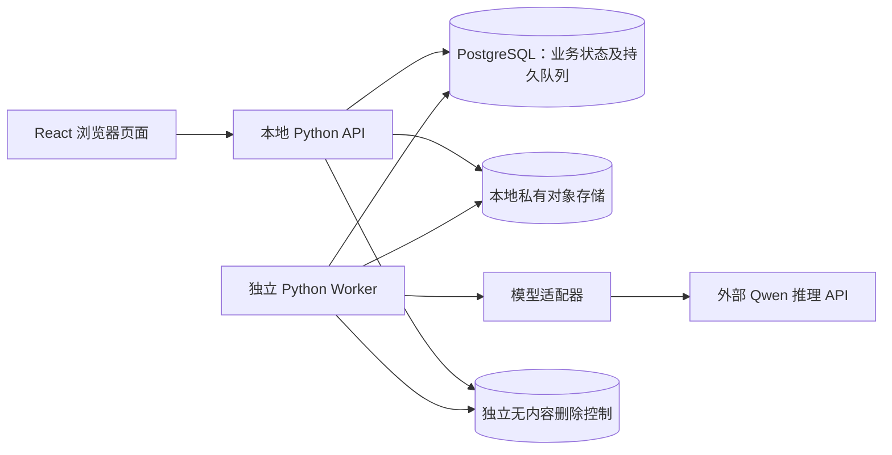

# Video Summary App 架构与详细设计

**状态：** 按 [ADR-005 / CR-001](adr/ADR-005-cr-001-deletion-troubleshooting.md) 更新的文档基线。ADR-001～004 历史保留，仅列明部分被替代。产品/架构责任边界已批准，具体实施设计待 CR-WP01 审核；新功能未实现/验收。S3-10 历史证据见 [REGRESSION_BASELINE](REGRESSION_BASELINE.md)。

## 1. 边界和决策状态

| 事项 | 状态 | 依据或处理 |
| --- | --- | --- |
| 模块化应用、持久队列、独立 Worker | 已批准 | [ADR-001](adr/ADR-001-modular-app-queue-worker.md) |
| 仅因同用户活动任务受阻时有限越过队首 | 已批准 | [ADR-002](adr/ADR-002-conditional-bypass.md)；原排序键仍有效 |
| 评测资料反向关联并随源任务删除 | 已批准 | [ADR-003](adr/ADR-003-linked-evaluation-cleanup.md) |
| 本地 API、数据库、队列、媒体/结果和日志；无新增内容备份 | CR-D09 已批准 | 部署避免含内容整库备份/快照，历史副本按 CR-D10 治理；外部仅模型推理且非全流程本地。 |
| TypeScript + React + Vite、Qwen3.8-Omni-Flash | 已确认方向 | 模型为 MVP 指定选择，能力、费用和条款仍待验证 |
| 方案 B；Python API/Worker、PostgreSQL、S3 兼容私有对象存储 | 已批准 MVP 基线 | ADR-004；具体产品、版本及性能仍须验证 |
| PostgreSQL 持久队列、同源静态前端、Docker Compose | 已批准首轮实施默认 | ADR-004；保留配置和实测后调整空间 |
| 输入容器为 MP4/MOV；视频 H.264/AVC，音轨若存在为 AAC/MP3 | 产品负责人于 2026-10-29 批准收敛，保持 2h/2GB；WebM 已排除 | PRD §3、AC-03 |
| URL 仅限安全校验后的 HTTPS 直达媒体文件 | 已确认 MVP 产品范围 | PRD §1/§3；平台播放页面集成另行评估 |

环境输入：北京家庭局域网、Windows 11、Ryzen 7 5800H、32 GB 内存、RTX 3060 Laptop GPU；本机内置 SSD 和外接 SanDisk Extreme 55AE 为旧规划介质，须核实是否有历史副本，不再规划新的内容备份，应用日志位于 `E:\video-summary-app-log`。这些信息不证明容量或备份恢复能力。MVP 媒体边界为本地文件或合法 URL、单视频不超过 2 小时/2 GB，容器及编码白名单以 [PRD §3](PRD.md) 为准，不因模型支持范围而自动改变。

## 2. 运行单元与职责

API 和 Worker 是两个独立运行单元，业务模块可保留在同一代码库；不预先拆为多个微服务，也不增加独立 Broker。前端建议构建为静态资源并与 API 同源提供。数据库是任务、额度、租约、删除和审计元数据的唯一权威；媒体内容放私有对象存储。对象存储不是公开文件服务器。

| 模块 | 对外职责与边界 |
| --- | --- |
| 身份与授权 | 注册/登录/退出、密码哈希、服务端会话、角色与逐请求任务归属校验；管理员自己任务按所有权访问，其他用户内容核验当前排障请求/码、范围、期限和失效状态。 |
| 输入 | 接收本地上传或导入 URL；流式暂存、大小/时长/容器/codec/可解码性校验和授权确认；校验通过才创建可排队任务。 |
| 任务与额度 | 状态转换、三次机会及六小时恢复、实际开始扣一次、按最终分类退款、重试窗口/冷却/累计上限。 |
| 调度与 Worker | 按已批准排序和唯一越过条件领取；租约、心跳、失联恢复、媒体预处理、模型调用、融合和输出校验。 |
| 结果与评测 | 固定 JSON Schema 1.0 校验、中英文结果、时间戳；登记评测资料与源任务的可反向查找关联。 |
| 删除与审计 | 栅栏、资产登记、逐项清理验证、受控退避/限频、部署者可发现信号及审计式诊断/再推进、最小审计；历史副本过渡治理。 |
| 排障请求 | 普通用户成功创建码即入独立管理员有效队列；单任务唯一有效授权、24小时；失效退出，删除请求同时撤销授权。 |

## 3. 核心数据与状态（设计默认）

建议的最小持久实体：`users`、`sessions`、`tasks`、`task_attempts`、`quota_events`、`retry_events`、`media_assets`、`evaluation_links`、`task_consents`、`audit_events`、`cleanup_jobs`、`cleanup_alerts`。每项必须有明确所属用户/任务、UTC 时间与保留期限；媒体对象仅记录受控对象键和必要元数据，不在任务日志中保存正文或带凭据 URL。CR-001 将 task_consents 旧目的模型切换为请求/授权实体，并调整清理/备份字段；建议同一请求承载授权避免双状态分叉。上述旧实体不要求原样保留，具体表名、字段、状态、约束、索引、迁移及清退在 CR-WP01 审核。

用户界面只展示 `Queued`、`Processing`、`Completed`、`Failed`、`Cancelled`。内部可有校验、待重试、清理中等状态，但它们不得扩展用户可见状态。已完成或已取消任务不得被迟到 Worker、取消或模型响应改写；失败任务仅能通过已接受的重试重新排队；删除栅栏优先于所有产生新内容的动作。`SUCCEEDED` 映射为 `Completed`。任务和资产、普通日志自任务创建起30天，删除审计自各事件时间起90天；未完成作业留必要控制，不冒充成功。历史副本过渡期仍遵守原删除后30天义务，实际处置先批准，不新增内容备份。

| 内部状态转换 | 触发和必须同时保持的不变量 |
| --- | --- |
| 校验通过 → Queued | 记录 UTC 排序键；不扣处理机会。校验失败不入队。 |
| Queued → Processing | 持久领取、租约代次、活动名额、开始时间和首次扣额在同一权威事务内提交。 |
| Queued → Cancelled | 移出可领取集合；不扣额。 |
| Processing → Completed | 当前租约代次有效、未取消/删除、JSON 校验通过且结果资产已登记。 |
| Processing → Failed / Cancelled | 记录最终分类；符合退款条件且有未返还扣额才退款；取消不退款。 |
| Failed → Queued | 仅接受符合滚动窗口、冷却和累计上限的重试；同一任务不再次扣额。 |
| 任意非删除状态 → 删除中 → 清理完成 | 首先设置删除栅栏及访问拒绝；每项资产完成清理后才报告对应完成状态。 |

**接口草案（设计默认）：** API 提供注册、登录、退出；本地文件上传建任务、URL 导入建任务；任务列表/状态/结果/双语 JSON 下载；取消、重试、删除；普通用户排障授权/重新生成/撤销；管理员元数据、码精确解析、有效请求列表和删除请求。移除产品删除回执、人工清理/备份核验接口，后台诊断方式先审核。所有任务读取和变更由后端按当前会话、任务所属用户、角色及有效授权检查；管理员接口不因管理员身份自动提供原视频/正文。大文件上传必须支持限额与中断清理，具体分块协议和 URL 路径名在接口评审时定，不在此锁定。

## 4. 输入、模型与输出流程

1. API 校验登录、任务所有权及用户处理授权；本地文件和 URL 均先进入本地私有暂存。URL 首轮仅接受经安全校验的 HTTPS 直达媒体文件；验证每次重定向目标及解析地址，拒绝本机/内网目标、危险重定向和超限下载。
2. 服务端依据实际字节、容器、codec、时长和可解码性判断是否合法。超限或不支持时停止，校验阶段不扣机会；不得静默截断。通过后按 UTC 提交时间和用户/任务 ID 入队。
3. Worker 领取后必要预处理，并对画面和音频分别取得证据，再按时间融合事件、生成摘要和时间戳。首轮优先验证完整合法视频的官方传输路径；只有证据表明单次输入不适用时才设计分段及全局时间映射，检验边界遗漏、重复和音画冲突。
4. 模型适配接口只接受必要媒体或片段、提示、输出约束和版本信息，返回结构化候选、用量、请求标识或分类错误。业务状态机不依赖供应商 SDK 响应形状。服务端验证 [PRD Schema 1.0](PRD.md) 的可解析性、字段、语言和时间顺序；无效结果不得作为成功文件交付。
5. 两种输入均不把用户原始 URL、邮箱/用户 ID、本地路径、用户访问令牌或无关日志交给模型。服务商可能收到完整媒体或必要片段/帧、音频、转写、时间戳、提示、JSON 约束及受控临时媒体 URL；结果、用量和错误返回适配器。密钥只由服务端从不跟踪的 `.env` 注入，仓库仅保存 [.env.example](../.env.example)。

家庭局域网私有文件不能直接作为 Qwen 可回连 URL。已批准的方向是在确有必要时使用短时、只读、任务限定、可撤销的模型访问 URL；公网入口的具体形式和防护仍须验证，不能公开整个文件夹或对象存储。若该路径不可行，先核实官方其他适用于 2 GB 的输入方式，再提出分段或最小产品变更方案。Qwen 的格式、2h/2GB、JSON、时间戳、延迟和实际费用都仍待验证；技术信息使用前复核[Qwen Omni 文档](https://help.aliyun.com/zh/model-studio/qwen-omni)及[模型页面](https://www.qianwenai.com/models/qwen3.8-omni-flash)。

### Qwen API 接入依据（2026-10-29 查阅，尚未发起请求）

| 项目 | 文档依据与设计含义 |
| --- | --- |
| 接入 | [模型页 API 参考](https://www.qianwenai.com/models/qwen3.8-omni-flash)示例使用 OpenAI Python SDK、`OpenAI(api_key=os.environ["DASHSCOPE_API_KEY"], base_url=...)`、模型 ID `qwen3.8-omni-flash`、`modalities=["text"]`、`stream=True` 及 `stream_options={"include_usage": True}`。它只演示文本问答，不能据此证明视频路径已测试。 |
| 视频消息 | [Qwen Omni 官方示例](https://help.aliyun.com/zh/model-studio/qwen-omni)使用 `messages` 中的 `content` 数组：`{"type":"video_url","video_url":{"url":"https://..."}}` 加文本提示；模型可同时理解视频画面和声音。应用只传经本地校验后受控的媒体 URL，不直接转发用户原始 URL。 |
| 限制 | 官方 Omni 页列视频公网 URL ≤2 GB、≤2 小时；Base64 输入编码后 <10 MB。模型页列 1M 上下文、991K 最大输入、131K 最大输出。产品白名单仍由 PRD 规定；本项目首轮只接受 MP4/MOV，不能从模型页泛称的视频支持推断其他容器已获支持。 |
| 输出与用量 | 该模型只输出文本。流式消费要累计文本，并读取可能单独到达、没有 `choices` 的最终 usage 片段；保存请求 ID、Token 用量和错误分类。页面标价为输入 ¥0.8/百万 Token、输出 ¥2.7/百万 Token、缓存命中输入 ¥0.1/百万 Token；实际账单及失败费用仍需核对。 |
| JSON | [结构化输出说明](https://platform.qianwenai.com/docs/developer-guides/text-generation/structured-output)列 Qwen3.8-Omni-Flash 的 JSON Object 模式，但它不保证固定字段类型；适配器可请求 JSON Object，后端仍须按 PRD Schema 1.0 校验，不合格不能交付。 |
| 本地配置 | `DASHSCOPE_API_KEY` 已在未跟踪的 `.env` 设置；Python 的 `os.environ` **不会自动读取文件**，未来服务进程须安全加载该文件或由运行环境注入。[千问AI平台 API Key 说明](https://platform.qianwenai.com/docs/api-reference/preparation/api-key)将当前 `https://maas.qianwenaiapi.com/compatible-mode/v1` 列为按量付费 Key 的 OpenAI 兼容地址；[.env.example](../.env.example)与本地配置一致。不能仅凭地址证明实际推理路由或模型视频能力；不得把 Key、带凭据媒体 URL 或完整请求正文写入日志。 |

以上价格、可用性和限制来自页面资料，属于截至查阅日的文档证据，不是本账号实测或固定费用承诺。无需因阅读示例而安装 SDK、运行示例或发起计费请求。

## 5. 调度、租约、额度与重试（已批准首轮默认，待测试）

同一数据库事务内，调度者按校验后的 `(submitted_at_utc, user_id, task_id)` 查找最早可运行任务；仅当更早任务的**唯一**阻塞原因是所属普通用户已有活动任务时，才可越过。全局名额不足时不越过；同一用户保序；管理员无优先级。领取同时记录原排序键、阻塞/越过原因、开始时间、活动名额和唯一扣额事件。事务加唯一约束保证两个 Worker 不重复领取或扣额。全局并发值和排队容量保持可配置，依据 ≤5 人同时上传、10–30 人使用的测量确定，不预填未经批准的数字。

每个有效领取持有带代次的租约；心跳续约，过期后的新领取提高 `lease_generation`。Worker 写状态、结果或资产前必须用当前代次、未取消且未删除的条件事务校验；旧 Worker 恢复后不得写入。首轮可配置默认是 120 秒租约、30 秒心跳，须由故障注入验证，不能把它们视为产品需求。远端请求结果未知时避免立即并发重发，以免重复外部费用。

额度通过持久事件流水与余额事务控制：队列取消不扣；首次实际开始仅扣一次；处理中取消已扣不退；同任务重试不再扣。内部错误、模型超时/限流/不可用及未知错误按 [PRD §4](PRD.md) 退款，且只可返还尚未返还的已扣机会，余额封顶 3。Worker 崩溃导致内部失败同样适用；外部 Token 费用独立记账。失败、取消、退款竞态以最终状态和可审计原因决定。手动和自动重试共用滚动 5 分钟、第 5 次触发冷却、累计 20 次接受上限及 1/5/15/30 分钟阶梯；重复请求键不重复计数。冷却/上限拒绝不启动处理。第 4 次及更晚模型超时重试仍不额外扣机会，UI 提示可能的 API 费用。

## 6. 删除、排障授权和历史恢复边界（CR-001）

删除前验证会话、CSRF和所有权，持久化独立删除意图并在权威事务设置删除栅栏、失效租约代次/重试，同步终止排障授权及请求。接受后列表移除并拒绝读取，返回接受不表示内容已清除。外部存储和数据库并非原子事务，保留独立意图、启动重放和故障补偿。

media_assets 和 evaluation_links 覆盖原片、音频、帧/片段、SQL结果/导出、临时文件、缓存、关联评测副本/标注/输出/失败案例。逐项幂等清理，实际验证正文、对象、目录消失及受控生产停止后才标成功；代次失效不单独证明任意线程或外部模型已停止。删除依据可信归属登记，不能整体清空共享 bucket/目录，不能把权限错误/超时当不存在。

移除删除记录、人工清理和备份核验产品页面/专用API，保留后台作业和诊断。临时故障退避限频，持续故障留部署者实际可发现的持久信号；危险路径/归属不明停止自动删除。受控诊断和再推进有审计，具体参数/发现路径/命令由 CR-WP01 审核，不能留下无人处理的 MANUAL_REQUIRED 停等。

管理员自己的任务按所有权直接读；普通用户授权为摘要（中英文与JSON）、视频或两者。系统码关联唯一任务，最多一有效码，成功创建起24小时。生成/替换、撤销、请求删除及任务删除在一致事务终止旧授权；请求入列与授权成功不可分离。只列最新有效普通用户请求，按创建时间/ID升序；失效立即退出，新请求重新排队，无历史管理页。

手动输入与列表共享服务端鉴权；解析不签发脱离原授权的长期权限。后续读取及流式续传复核当前管理员会话、请求/任务/用户关联、范围、期限和撤销/替换/删除。码不替代认证，不进公开URL/普通日志或不必要浏览器持久存储，无效查询合理限速。已渲染/下载内容无法从外部设备收回。

删除审计按各事件时间90天到期清理；完成后收缩资产位置/任务详情/凭证，仅最小无内容审计及必要控制。未完成作业留必要执行控制直到完成或授权解决，不因此延长内容保留承诺；其他审计期限另行设计，不默认90天。

不主动创建内容备份，部署避免新增含内容整库备份/系统快照，可留无内容的软件重建资料。历史副本先清点隔离核实，获专项批准再清理；处置完成前保留 BACKUP 清理及恢复防复活。正常启动依赖的 deletion_control/共享卷不能随页面删除。获准恢复先隔离服务、重放删除控制、终止旧会话及新旧授权，再验证后开放；过旧/证据不足快照不得绕过检查。

完成验收覆盖应用实际受控SQL正文、对象、文件/目录及内容资产；不等于数据库MVCC/WAL或存储历史字节/SSD安全擦除，不保证清除下载和供应商副本。软件重建不等于原片、摘要、账户及元数据可恢复。

## 7. 运行与验证边界

本地运行首轮采用 Docker Desktop/Compose 管理 API、Worker、PostgreSQL 和对象存储；S3-12 验证 Windows 11、持久卷/网络/同源静态前端、升级和诊断；不再设计内容备份频率或常规内容恢复。旧介质及自动快照先核实，专项批准后退役，完成前保留必要能力。前端 Vite 供开发和构建。外部 Qwen 仅用于推理，应用日志位于本机 E 盘；服务商数据及日志不由本机目录控制。

实现阶段先用模型替身完成注册/隔离、输入校验、队列与额度竞态、租约过期、取消/重试、JSON 校验、删除/评测关联、备份恢复防复活的模块测试与端到端回归。容量测试记录本机环境、用户/上传数、队列等待、锁等待、CPU/内存/磁盘、失败恢复和费用。60 分钟成功任务 P90≤20 分钟是未验证目标，按实际开始到成功完成计算，失败另报；15 个授权视频由项目负责人在本地 UI 手动建立质量基线，±5 秒仅为初始时间戳容差，正式质量阈值待基线后确定。可用性/成功率 SLO 和 JSON 自动修复次数明确延期。

**外部调用准入：** 产品负责人已确认审阅并同意当前 Qwen 账号条款，不再要求重复批准条款。MVP 每个计费测试批次仍须先交代目的、数据类别、请求/重试量、费用估算与失败费用、外发字段和硬预算，得到用户明确批准。真实视频或评测素材外发前，还须验证受控媒体访问路径与实际网络暴露边界；本机 E 盘日志不代表服务商留存。提供 Key 不等于批准调用；正式运行前配置预算与限额。不得据此文档发起调用或上传素材。

## 8. 需求、设计与验证追踪

| 质量场景 | 需求或决策 | 设计位置 | 后续验证 |
| --- | --- | --- | --- |
| QA-01 成功任务 P90 | PRD §8、AC-12 | §7 | 记录环境、负载、样本及实际处理时长；未验证。 |
| QA-02 媒体与 URL | PRD §3、AC-03/21 | §4 | 白名单、边界、损坏、SSRF 与重定向。 |
| QA-03 排序和并发 | PRD §5、ADR-002 | §5 | 平手、越过、全局饱和与长期等待。 |
| QA-04 额度和恢复 | PRD §4、ADR-001 | §3/5 | 重复领取、崩溃、退款和取消竞态。 |
| QA-05 身份隔离 | PRD §2、AC-01/02/17、CR-AC-06～21/23 | §2/6 | 所有者、码/范围/24h、替换/撤销/请求删除、旧API切换及统一鉴权。 |
| QA-06 删除与恢复 | PRD §7、ADR-003/005、CR-D09～16 | §3/6 | Worker竞争、重试/诊断、危险删除、最小审计、历史副本和获准恢复。 |
| QA-07 双语 JSON | PRD §6、AC-13～15 | §4 | Schema、语言、时间顺序及失败路径。 |
| QA-08 质量基线 | PRD §9、QUALITY_EVALUATION | §7 | 15 个授权视频、单人标注、±5 秒初始容差。 |
| QA-09 诊断审计 | PRD §5/7、AC-18～20 | §3/5/6 | UTC、越过/退款/删除记录与 30/90 天清理。 |
| QA-10 本地/外部边界 | PRD §1/3、ADR-001 | §1/2/4/7 | 资产位置、外发字段、账号条款和入口审批。 |

## 9. 尚待验证或实施时确定

| 事项 | 下一证据或决定 |
| --- | --- |
| 最终架构基线 | 已由产品负责人批准，见 ADR-004；模型媒体路径、队列故障恢复和删除行为仍需实测，不是已通过的验收结果。 |
| URL 首轮支持范围 | 已确认为安全校验后的 HTTPS 直达文件；平台播放页面集成另作权利和技术评估。 |
| 本地媒体外发路径 | 官方视频 URL 方式已有文档依据；本地私有媒体如何形成受控、可撤销的模型访问 URL，以及 2h/2GB 实际表现仍须验证。公网入口具体配置须在外发真实素材前审查。 |
| Qwen 账号与端点 | 产品负责人已确认条款；本地 `.env` 的通用按量付费地址与平台 API Key 文档一致，无需因前次北京示例修改。实际模型访问、推理路由、用量和费用仍靠获批测试与账单验证。 |
| 本地容量与无内容备份部署 | S3-10旧结果保留，新授权/列表负载另测；S3-12核实副本、避免新内容快照、批准处置，交付软件重建和不可恢复范围。 |
| 会话与运营参数 | 原认证默认继续；CR-WP01审核码限速、清理退避/频率/故障阈值及部署者发现/命令，无管理员人工清理页。 |

以上实测和配置项可并行准备不计费的测试与设计；不能据此声称模型能力、性能、费用或容量已经验证。

## 10. 实施设计提案（待审核，不是执行授权）

| 方面 | 候选方向 | CR-WP01输出 |
| --- | --- | --- |
| 生成/存储 | 高熵随机码，摘要查找，认证加密支持主体再次展示 | 位数/编码/碰撞重试、密钥/nonce/轮换、不可解密拒绝、日志脱敏。 |
| 数据/期限 | 单一请求承载授权，复合归属外键，静态当前状态唯一约束加实时到期检查 | 表/索引/约束、状态转移；不用随时间变化的索引谓词，不依赖整理任务及时运行。 |
| 原子/幂等 | 同任务锁序一致，锁后记服务端时间，提交后展示 | 24h边界、重试幂等、替换/终止回滚；删除旧请求不撤销新请求，重启不重置。 |
| 访问入口 | POST请求体解析码，后续会话/请求ID访问 | 码不进URL，请求ID不替代权限，摘要/导出/视频/Range/续传统一复核。 |
| 清理/诊断 | 持久退避及可发现故障，危险删除停止 | 参数及命令先审核，验证权限/归属/审计、故障/重启，替代旧停等。 |
| 切换/退役 | 追加迁移，终止旧目的授权，历史能力延后清退 | 版本兼容/无旁路、无副本自动删除、无内容备份准备；正式切换和清理另授权。 |

详见 [工作包](CR-001_IMPLEMENTATION_PLAN.md) 和 [测试规格](CR-001_TEST_PLAN.md)。本轮不创建SQL迁移或运行新测试；上表细节不得当成已批准默认。

## 11. WP01实施设计交付（技术提案，待产品审批）

产品负责人已接受WP00并授权WP01设计及独立多Agent审查，未授权WP02～07。共享冻结契约C0.3见[CR-WP01_CONTRACT](CR-WP01_CONTRACT.md)；[数据/API](CR-WP01_DATA_API_DESIGN.md)具体化单权威请求、静态唯一/实时TTL、160位码、AES-GCM/nonce/key生命周期、幂等CAS及共享内容鉴权；[删除运维](CR-WP01_DELETION_OPERATIONS.md)定义生产SH/清理EX继承、持久清理状态/退避/信号、受限ops事务和完成边界；[切换回退](CR-WP01_CUTOVER_ROLLBACK.md)定义扩展迁移/显式M3、旧角色失权、恢复epoch/真key与前向修复。

上述具体表/参数/算法/命令是WP01可审核提案，不因本节列出而自动批准。core与support就绪分开：密钥事故不剥夺所有者原内容，epoch/删除控制失信不得降级；无缓存ID的所有者可取无码Meta撤销/重生。维护轮换不承诺热重载，键级事务保护退役并发。

独立[测试设计](CR-WP01_TEST_REVIEW.md)和[安全审查](CR-WP01_SECURITY_REVIEW.md)发现由主Agent协调，最终裁决/批准参数/派发记录见[评审报告](CR-WP01_REVIEW_REPORT.md)。设计关闭仅指文档处理，真实DB、FFmpeg继承锁、角色/恢复及故障验证仍未执行。D-01～CR-D16无新增产品歧义，不覆盖旧ADR历史及S3-10证据。完成后仅提交WP01评审，等待产品验收及WP02独立授权。
