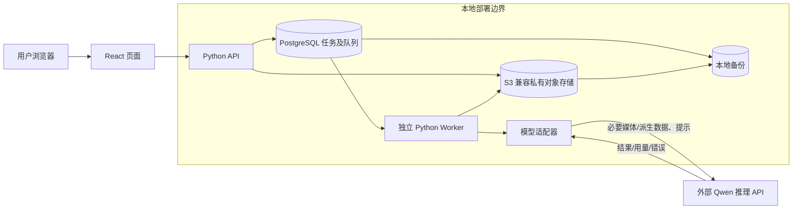

# Video Summary App — Step 2 技术栈与架构重建规划

**状态：** 审查稿；2026-10-28 基于远端旧版需求和当前聊天中后续批准决定重新编制。不是丢失文件的逐字恢复，也不是最终获批的 Step 2.5 架构基线。  
**基点：** GitHub `main` 提交 `68cdcbb` 恢复的七份 Step 1 文档，经 2026-10-28 用户决定定点更新；[决策来源记录](CURRENT_DECISION_BASELINE.md)；[ADR-001](adr/ADR-001-modular-app-queue-worker.md)、[ADR-002](adr/ADR-002-conditional-bypass.md)、[ADR-003](adr/ADR-003-linked-evaluation-cleanup.md)。  
**范围：** 重做 Step 2.1～2.5 的分析、候选比较、技术默认与验证计划；本轮同步 Step 1，不实现代码、不调用付费 API、不上传素材、不提交或推送。

## 执行摘要

方案 B（模块化应用 + 持久队列 + 独立 Worker）已获有条件接受，是当前验证起点。首轮技术默认为 TypeScript + React + Vite、Python API/Worker、PostgreSQL、本地部署的 S3 兼容私有对象存储；先评估 PostgreSQL 持久队列，不预设独立 Broker。Qwen3.8-Omni-Flash 是指定 MVP 模型。以上方向与 ADR-001～003 不冲突，最终基线仍需依据真实输入、队列恢复、安全/删除和费用证据审查。

**首要可行性问题：** Qwen 官方视频说明的 2 GB 文件输入采用可供服务商访问的 URL，Base64 本地文件输入上限远小于产品 2 GB 上限。北京家庭局域网内的私有媒体不会自动成为模型可访问的公网 URL，因此完整视频如何安全送达模型 API 仍是实施前必须批准的设计问题。不能在没有网络/数据条款审查时假定本地私有存储天然可被模型读取；也不能因接口限制静默缩小已确认的 2 小时/2 GB 产品范围。[Qwen Omni 官方输入文档](https://help.aliyun.com/zh/model-studio/qwen-omni)

## Step 2.1 — 架构驱动因素

重要性依据是违反后的产品、安全或运营后果，不是主观分数。旧版远端需求的冲突项目已同步至本地 Step 1，历史差异见 CD 记录。

| ID | 驱动因素与类型 | 来源 | 重要性及影响 | 验证/后续 |
| --- | --- | --- | --- | --- |
| AD-01 | 本地上传或 URL 导入→真实媒体校验→必要预处理→画面/音频分析→时间融合→摘要/时间戳→JSON 校验；功能 | PRD §1/§3/§6；AC-03/13～15/21 | **极高：** 核心流程不完整即无法交付视频理解。影响任务阶段、媒体与模型边界。 | 白名单兼容矩阵、URL 安全、音画证据和端到端场景。 |
| AD-02 | ≤2h/2GB、格式/编码白名单；硬约束 | CD-01；旧 AC-03 | **极高：** 模型路径若不能接收合法输入，会违背产品入口。影响上传、传输、分段。 | 接近/达到边界的受控验证；不截断。 |
| AD-03 | 60 分钟成功任务处理 P90≤20 分钟，不含排队；质量目标 | CD-08；PRD §8；AC-12 | **高：** 超目标影响主要体验；需隔离排队与执行计时。 | 记录环境、负载、样本数；成功样本计 P90，失败另报。 |
| AD-04 | 私有账户、角色不可自升、管理员内容访问需任务级同意；安全/业务规则 | PRD §2；AC-01/02/16/17 | **极高：** 越权可泄露视频与结果。影响所有 API、对象访问和审计。 | 后端授权矩阵、跨用户与管理员绕过检查。 |
| AD-05 | 3 次机会、6h 恢复、开始扣额、分类退款/同任务重试不另扣；业务规则 | PRD §4；AC-04～09 | **极高：** 重复执行会错扣/多退；必须以事务与幂等键实现。 | 重复投递、取消/错误竞态、Worker 崩溃验证。 |
| AD-06 | 有限条件越过队首、同用户顺序和全局并发；业务规则 | CD-02；ADR-002 | **高：** 错调度会违反公平与并发限制。影响领取、锁和日志。 | 排序、平手、饱和、竞态及长期等待模拟。 |
| AD-07 | 30 天在线保留/删除、备份最迟删除后 30 天清除、删除审计 90 天；硬约束/隐私 | PRD §7；AC-18～20 | **极高：** 数据残留/误报删除成功会损害隐私。影响资产登记、备份恢复。 | 删除清单、部分失败、恢复重放演练。 |
| AD-08 | 评测副本、标注、输出、失败案例随源任务关联删除；已批准架构约束 | CD-03；ADR-003 | **极高：** 脱钩副本可能绕过用户删除。影响评测库和反向索引。 | 从 task 枚举全部资产、清理和重建阻断检查。 |
| AD-09 | 应用/数据本地部署，外部模型推理为唯一已确认外部运行服务；硬约束 | CD-04 | **极高：** 错误外发扩大第三方处理范围。影响部署清单、请求最小化。 | 核对持久数据位置与模型请求字段；条款/区域前置审查。 |
| AD-10 | Qwen3.8-Omni-Flash 指定；2h/2GB API 可行性与媒介 URL 未证实；待验证假设 | CD-05；[官方文档](https://help.aliyun.com/zh/model-studio/qwen-omni) | **极高：** 完整视频传输路径可能决定方案可实施性。影响本地对象存储、网络边界和分段。 | 合成/非敏感接口计划；任何计费测试另行授权。 |
| AD-11 | 中文/英文语音和摘要、固定 JSON 1.0；质量与功能 | PRD §6；AC-13～15 | **高：** 格式错误/事实错误使交付无效。影响 Schema 校验、模型适配和评测。 | 本地 Schema 校验；15 视频基线。 |
| AD-12 | 15 个授权视频、单人标注、±5s 初始时间戳容差；可测试性 | CD-07；QUALITY_EVALUATION | **高：** 无证据无法制定正式质量阈值。影响版本记录和评测资料生命周期。 | 留输出/标注/失败案例，披露样本与标注局限。 |
| AD-13 | 个人实验项目，少组件、易本地运行和调试；可维护性/成本 | 本次用户项目背景；CD-06 | **中高：** 过度拆分增加单人运维与故障面。影响框架、队列、部署单元。 | 用实际复杂度、故障定位和成本验证默认。 |
| AD-14 | API 费用个人承担；MVP 计费测试按批次审批，正式运行受配置预算/限额约束；业务/安全约束 | CD-05 | **高：** 未授权调用带来费用和外发风险。影响实验计划、自动重试、密钥管理。 | 每批注明数据/次数/估算/失败费用并获批准；运行阶段限额未设置时不自动计费。 |

**依赖与潜在冲突：** AD-02/10 与 AD-09 共同要求解决“本地私有视频如何被外部 Qwen 读取”；AD-03 与 AD-06 的单用户限制/队列积压不同口径，P90 不能混入等待；AD-07/08 与评测可复现性存在删除后基线缺样本的取舍；AD-05/06 与重复领取要求统一事务语义；AD-13 的简化不能减弱 AD-04/07/09。

## Step 2.2 — 质量属性场景

下表是审查用场景；有数字的仅采用已确认值。未给的负载、阈值和容量不得自行填数。

| QA | 刺激与环境 | 预期响应及现有衡量 | 状态/验证 |
| --- | --- | --- | --- |
| QA-01 性能 | 60 分钟合法视频成功处理，记录具体本地环境及并发负载 | 实际开始→成功完成 P90≤20 分钟；排队不计，失败另报 | **需求已定，未验证**；CD-08/AC-12。样本量/代表负载待定。 |
| QA-02 媒体输入 | 本地文件或 URL 的允许/边界/不支持/损坏/无音轨输入 | 服务端按真实容器、codec、时长/大小及可解码性校验；URL 阻止内网访问、危险重定向和超限下载；无音轨可做视觉理解 | **双输入已定**；CD-01/09、AC-03/21。实际组合兼容待测。 |
| QA-03 调度与并发 | 多用户同时间、同用户已有活动任务、全局资源占满 | 原排序键；仅 ADR-002 唯一阻塞条件可越过；用户与全局并发不超限 | **行为已批准**；公平策略/容量待定。 |
| QA-04 可靠性与额度 | 重复通知、Worker 退出、模型超时/限流、取消与退款交错 | 状态可恢复；仅开始扣一次；分类退款最多一次；重试共用上限/冷却 | **规则已定，机制待验证**；PRD §4、ADR-001。 |
| QA-05 身份与隔离 | 未登录、伪造管理员、跨用户或管理员无同意访问内容 | 服务端拒绝，管理员任务级同意和无正文审计 | **要求已定**；PRD §2、AC-01/02/17。 |
| QA-06 删除与恢复 | 用户删除、部分清理失败、异步回调/备份恢复 | 即时撤销访问并启动清理；自动重试 >3 次或 >30 分钟未完成通知管理员；所有关联资产实际清理后才报成功；备份≤30天、普通日志30天、审计90天 | **规则已定，机制待测**；ADR-003、AC-18～20。 |
| QA-07 输出 | 中文/英文音视频，模型给出无效 JSON 或时间顺序 | 应用校验固定 JSON 1.0、语义/语言；无效不得成功交付 | **结构已定**；修复次数待配置，质量阈值延期。 |
| QA-08 评测可复现 | 15 授权视频、单人标注、模型/提示变更 | 保存输入关联、输出、标注、指标、失败案例；报时间误差中位数/P90/±5s比例 | **流程已定**；不宣称双人复核或泛化。 |
| QA-09 审计诊断 | 任务、越过、退款、内容访问和删除事件 | UTC 记录必要状态/原因/时间/结果，避免正文和秘密；普通任务日志30天、删除审计90天 | **期限已定，实施待测**；PRD §7。 |
| QA-10 本地部署与模型数据 | 检查服务/存储位置、外发请求或真实视频 API 调用 | 仅模型推理外发必要媒体/派生信息；真实素材前核实区域、留存、训练用途、条款、费用 | **边界已定，提供方条款待验**；CD-04/05。 |

## Step 2.3 — 实质不同的候选架构

| 方案 | 核心执行/状态 | 优点 | 主要代价和适用条件 |
| --- | --- | --- | --- |
| A 同步模块化应用 | API 请求内完成预处理、模型调用和结果；少量组件。 | 初期调试直观。 | 长视频请求超时/取消/恢复困难，交互与媒体负载争用；与已批准的独立 Worker/持久队列方向不符，只适合另获批准的短任务产品。 |
| **B 模块化控制面 + 持久队列 + 完整任务 Worker** | 控制面负责授权、任务/配额、调度；数据库持久化任务；独立 Worker 完成媒体处理、模型调用、融合、输出校验。 | 满足 ADR-001；部署单元少，长任务与 UI 请求分离；可在任务级恢复/审计。 | 仍需严格设计租约、幂等、删除栅栏和本地运维；需实测 PostgreSQL 队列与 Qwen 媒体路径。**当前有条件基线。** |
| C 持久多阶段工作流 + 多 Worker 池 | 预处理、音频、视觉、融合、校验各持久阶段与独立处理池。 | 阶段级重试/扩缩可更细。 | 状态/产物/备份/删除扩散到更多边界，单人开发与运维负担高；只有证据表明某阶段必须独立扩缩或恢复时才考虑。 |

三方案都必须落实服务端租户隔离、ADR-002 的调度语义和 ADR-003 删除；结构本身不保证它们。

## Step 2.4 — 对照与推荐

等级仅表示相对设计难度或潜力，不是已测性能或精确成本。

| 维度 | A | B | C | 依据 |
| --- | --- | --- | --- | --- |
| 租户隔离/认证 | 中 | 中 | 较复杂 | 任一方案都需后端逐请求授权；C 增加服务间身份边界。QA-05。 |
| 删除、备份、评测关联 | 中 | 中 | 高复杂度 | C 的派生产物与恢复边界更多。ADR-003、QA-06。 |
| 60 分钟 P90 可行性 | 证据不足且长请求风险高 | 证据不足，具隔离优势 | 证据不足，阶段并行潜力 | 模型传输/延迟可能主导；不能凭架构承诺。QA-01。 |
| 失败/取消/额度一致性 | 长请求补偿复杂 | 可在单任务事务边界集中设计 | 跨阶段状态多 | ADR-001、QA-04。 |
| 可配置并发/积压 | 弱 | 中 | 强但复杂 | 负载数据尚无；B 可调整 Worker 数量。QA-03。 |
| 可维护/可测试 | 初期简单，长任务难复现 | 最符合单人项目 | 最多接口和测试组合 | AD-13、QA-08/09。 |
| 运行/开发成本 | 初期低，失败补救成本未知 | 中、待测 | 高且待测 | API 费用/媒体存储/机器尚无实测。 |

**暂定推荐 B 的最小实现形态：** 一个模块化代码库，API 和独立 Worker 两个应用运行单元；PostgreSQL 作为业务和队列状态权威；本地 S3 兼容私有对象存储放媒体与结果；模型适配接口调用 Qwen。C 不作为 MVP 首选，A 不能在不重新批准 ADR-001 的前提下替代 B。引入独立 Broker 的条件是目标负载下的锁等待、领取时延、恢复或运维证据明确显示 PostgreSQL 方案不够，而非预想未来高并发。

## Step 2.5 — 候选架构基线与技术状态

| 层/组件 | 当前状态 | 职责与边界 |
| --- | --- | --- |
| TypeScript + React + Vite | **用户已确认** | 浏览器 UI 和前端构建。首轮建议构建静态页面由本地 API 同源提供；不引入 SSR 或微前端。 |
| Python API 与独立 Worker | **首轮技术默认** | API 负责认证授权、上传/任务、查询/删除；Worker 负责视频任务。具体 Python Web 框架与进程管理待选，不在本稿定供应商/版本。 |
| PostgreSQL | **首轮技术默认** | 用户、任务、额度、调度、审计元数据、删除栅栏和评测反向关联的权威持久状态。 |
| PostgreSQL 持久队列 | **首轮候选默认，未实测** | 校验后按提交时间、用户 ID、任务 ID 排序；仅因同用户活动任务受阻时允许其他用户最早可运行任务越过。单一调度临界区控制全局/每用户活动名额；租约/心跳和单调递增 fencing token 防旧 Worker 写入。扣额、退款、状态转换用事务及唯一事件键幂等。 |
| 本地 S3 兼容私有对象存储 | **首轮技术默认** | 原视频、中间媒体、摘要/JSON、评测资料。具体产品未定；资产目录追踪每个副本及删除状态。备份介质为笔记本内置 SSD 与外接 SanDisk Extreme 55AE。 |
| Qwen3.8-Omni-Flash | **MVP 模型已确定，能力待验证** | 仅本地 Worker 内的模型适配器调用。模型/提示版本、请求用量、错误类型与费用记录；应用端校验 JSON Schema。 |
| 应用日志与备份 | **本地部署边界已确定** | 北京 Windows 11 家庭局域网测试；应用日志目录 `E:\video-summary-app-log`（已创建），只存必要元数据，不存秘密/正文；内置 SSD 与外接 SanDisk Extreme 55AE 作备份介质。自动恢复功能延期，但任何实际恢复先重放删除控制。服务商审计日志不受此目录控制。 |

**任务状态原则：** 服务端校验后入队。调度按 ADR-002 原排序键挑选可运行任务；取得任务租约、全局/单用户活动名额、记开始时间与扣一次额度必须受同一权威状态/事务控制。Worker 在阶段边界及模型返回后检查取消/删除；成功结果先经 Schema/业务规则验证。重复交付、崩溃、迟到回调、重试和退款只依据持久 attempt/事件键执行一次有效转换。租约失效时新 Worker 获得更高 fencing token；旧 Worker 即使恢复，写结果/状态时也必须被事务条件拒绝。具体 SQL/锁机制在详细设计与故障模拟后定。

**最低限度公平性建议默认：** 每次领取都挑选最早可运行任务，同一用户保序；Worker 租约过期后回收失联任务占用的活动名额，使受阻用户最终可重新运行；记录等待时长、被越过次数和阻塞原因。在预计不超过 5 人同时上传的负载下，以模拟/故障测试检查长期等待。若观察到饥饿，再提出可配置等待屏障，不先发明阈值。扩展到 10–30 人同时使用是容量设计目标，需实际测量，不能当成已验证承诺。

**删除原则：** task ID 对应的资产登记枚举原片、音频/帧/片段、JSON、导出、缓存及 ADR-003 评测资料。删除先撤销在线访问、设置持久删除栅栏并停止/取消任务，再幂等清理；Worker/迟到回调写入前检查栅栏；失败可追踪/重试，>3 次或 >30 分钟未完成生成持久告警供管理员后台查看；所有适用在线资产实际清理后才报成功。备份删除≤30天，任何手动恢复前重放删除控制，审计保留90天且无正文。自动恢复界面延期不意味着可从备份重新暴露已删数据。

**模型数据流：** 两种用户输入先由本地 API/Worker 导入私有存储并按同一白名单校验；不直接把用户原始 URL 交给模型。服务商可能收到完整视频或必要片段/抽帧、音频、转写、时间戳/最少上下文、提示和输出约束；若模型通过 URL 取件，还能访问短时受控媒体 URL。API 认证凭据通过服务端认证通道送达服务商，不进提示、URL、客户端、请求正文或应用日志。用户标识/访问令牌、本地路径、无关日志和无必要原始文件名不外发。供应商侧请求/结果/日志留存不受本地删除流程自动控制，必须核实条款。

### 模型输入、区域与费用的独立证据（2026-10-28 检索）

- [官方 Qwen Omni 文档](https://help.aliyun.com/zh/model-studio/qwen-omni)列出 Qwen3.8-Omni-Flash 的文本、图片、音频、视频输入与文本输出；视频 URL 输入上限 2 小时/2 GB，Base64 编码后不足 10 MB。故完整合法大视频的“本地存储→外部 API”传输方式尚需验证。图片/音频组合、WebM 及已批准容器/codec 组合不能从模型营销描述推断均可用。
- [官方结构化输出说明](https://help.aliyun.com/zh/model-studio/qwen-structured-output)及 [Omni 说明](https://help.aliyun.com/zh/model-studio/qwen-omni)表明 Qwen3.8-Omni-Flash 可用 JSON Object 模式，但不支持 API 强约束的 JSON Schema 模式；因此由适配器要求 JSON，应用后端按 PRD 的 Schema 1.0 校验，失败按既定规则处理，不能把模型 JSON 模式当成已满足导出契约。
- [模型价格](https://help.aliyun.com/zh/model-studio/model-pricing)当前北京价格表列输入 ¥0.80/百万 Token、缓存命中 ¥0.10、输出 ¥2.70/百万 Token；视频中的视觉与音频分别计费。纯假设的 1M 输入、10k 输出按该表约 ¥0.827，**不是 60 分钟视频报价**；实际用量、重试和可计费失败需用账户 usage/账单核对。
- [地域及接入域名](https://help.aliyun.com/zh/model-studio/beijing-access-information)区分接入地域、数据存储地域与推理部署范围；北京接入点不能单独证明所有推理都限于中国内地。模型价格表列 Qwen 北京服务部署范围为“中国内地”；本轮将中国内地推理列为真实视频外发准入条件，实际账号、模型版本和路由/条款仍须核对，不把它写成已验证的合规结论。
- [官方 Base URL 总览](https://help.aliyun.com/zh/model-studio/base-url)给出北京区域的 OpenAI 兼容接入地址；Key 与接入地域须匹配。仓库 `.env.example` 仅示例共享地址，账户开通后可改用所属业务空间的北京专属域名；此配置不单独证明实际数据留存或训练用途。
- [百炼隐私说明](https://help.aliyun.com/zh/model-studio/privacy-notice)明确调用数据会被存储；先前设想的服务商“零存储、立即删除”不成立，产品负责人已接受按所购渠道官方政策修订准入。具体留存期限、删除/备份及适用合同仍须核验；训练用途要排除 Token Plan 个人版的特殊授权。

### 媒体传输与分段的推荐默认

首轮先验证完整合法视频能否通过官方支持的传输方式完成理解，不预设切分或转码，也不静默截断。本地上传和外部 URL 均先导入本地，完成权限、大小、格式、解码与时长检查；外部 URL 还须防内网访问、危险重定向、超限下载和敏感查询参数泄漏。之后两者走同一个模型适配边界，原始用户 URL 不传给服务商。若使用模型可读取的受控临时 URL，须由用户先批准本地服务的实际公网暴露边界，并验证 URL 短时、只读、任务限定、可撤销、删除后失效和访问日志。若不能安全提供 URL，先核实官方是否有适用于 2 GB 视频的其他输入路径；目前官方 File API 单文件直传上限 10 MB，不能假定可替代。[百炼 File API 文档](https://help.aliyun.com/zh/model-studio/files-api/)

确有证据表明单次输入不可行时，再评估显式分段、全局时间映射、边界上下文、去重和融合；分段窗口及重叠时长需测试后定。检验范围包括完整覆盖、时间偏移、音画冲突、事件遗漏/重复、中英文摘要、JSON、±5 秒初始容差、P90、重试和总费用。若仍不能满足已确认产品边界，向用户报告差异和最小变更方案，不自行换模型或改 Step 1。

### 实施前建议默认与批准点

| 领域 | 单人项目首选默认 | 主要风险/替代路径 | 批准或验证状态 |
| --- | --- | --- | --- |
| 模型接口与秘密 | Worker 内最小适配接口；本机未跟踪的 `.env` 存 API Key 与接入配置，由服务端进程读取；仓库仅保留无密钥的 `.env.example`，Git 忽略真实 `.env`。 | 本机文件失窃或日志误打会泄漏凭据；限制文件访问、只在服务端使用，必要时轮换。 | 用户可自行填入 Key；提供 Key 不授权付费调用，实际端点/条款待核验。 |
| 计费实验 | 合成数据先行；每批计费测试前说明目的、数据类型/外发字段、调用/重试量、基于现价的估算与失败费用，并设置该批硬上限。 | 真实用量未知；超时或输出拦截仍可能形成账单，应以服务商账单核对。 | **MVP 每批须用户明确授权**；提供 API Key 不等于授权调用。正式运行按已配置预算与限额自动执行。 |
| 队列领取 | PostgreSQL 一份权威任务状态；短事务 + 租约/attempt；按最早可运行任务领取，记录越过原因。 | 锁竞争/恢复证据失败时才比较独立 Broker；Broker 不替代业务事务。 | 以 ≤5 同时上传与 10–30 同时使用做分层模拟；无需先定公平阈值，若出现饥饿再提交防护策略。 |
| 认证会话 | 持久账户、成熟密码哈希和服务端会话，安全 Cookie、CSRF、服务端逐请求租户检查；身份模块化；每次新登录要求密码，无免密码自动登录。 | MVP 无邮箱验证/审核，邮箱所有权未证实；密码找回延期。 | 实施默认：每账户滚动 15 分钟内 5 次错误密码后暂停 15 分钟；同一来源滚动 15 分钟内 20 次失败后暂停 15 分钟，注册入口亦使用来源限速；参数可配置并测试。实现完成后安全创建管理员账户。 |
| 前端运行 | Vite 用于开发/构建；生产静态资源与本地 API 同源提供。 | 若实际部署不便，再用本地静态 Web 进程；不先加 SSR/微前端。 | 北京 Windows 11 家庭局域网；公网入口未批准。 |
| 容量/成本 | 按实际 Windows 11 / Ryzen 7 5800H / 32 GB / RTX 3060 Laptop 环境，记录 5 人同时上传、10–30 人使用场景下的暂存/媒体/备份、CPU/内存、锁等待、领取延迟和 API usage。 | 只对所测负载有效；若 PG 队列不够再比较 Broker。 | 不预设全局处理并发、队列容量或 SLO 数值；清理告警 3 次/30 分钟已确定。 |

### 本地运行和测试的首选方案（建议默认，尚未安装）

推荐 Windows 11 上使用 Docker Desktop（WSL 2 后端）和 Docker Compose 统一运行 Python API、独立 Worker、PostgreSQL 与本地 S3 兼容对象存储；React/Vite 仅用于前端开发和构建。理由是单人项目可以用同一配置重复启动服务，且不增加独立消息 Broker。32 GB 内存满足 Docker 官方列出的最低 8 GB RAM 前提，但仍须检查 Windows 版本、WSL 2、虚拟化、磁盘空间和实际媒体负载；RTX 3060 并非外部 Qwen 推理的前置条件，本地预处理先以 CPU 路径验证。Docker Desktop 官方说明个人用途可免费使用，实际许可仍以安装时条款为准。[Docker Windows 安装要求](https://docs.docker.com/desktop/setup/install/windows-install/)

备份首轮放在笔记本内置 SSD 与外接 SanDisk Extreme 55AE；两者位于同一家庭环境，不应把介质数量当成已验证的灾难恢复能力。实施前需明确哪些数据落在哪个介质、断开外接盘时如何告警、删除后 30 天内如何从所有副本清除，以及恢复时如何重放删除栅栏。不在本文指定容量或备份频率。家庭局域网供本地用户访问；若模型须回连临时媒体 URL，是否开放公网入口必须另获产品负责人批准。

非模型应用的回归测试在实施阶段随模块编写：注册登录/角色与跨用户隔离、文件与 URL 导入安全、媒体白名单、配额恢复/退款幂等、队列排序/越过/Worker 崩溃、重试/取消、JSON Schema、删除/关联评测资料/备份恢复、普通日志 30 天与删除审计 90 天。用测试替身替代外部 Qwen，保证自动化测试不触发费用或上传素材。15 个授权视频的模型质量基线由项目负责人在本地应用界面手动执行，按 [质量评估计划](QUALITY_EVALUATION.md)的现有指标记录结果；不把这 15 次纳入自动化回归或伪称已通过。P90 目标单独在记录环境、负载与样本量后验证。

### 本轮补足的默认机制与费用审批

**队列/租约默认：** 小规模首发只设一个数据库调度临界区，按校验后的 UTC 提交时间、用户 ID、任务 ID 扫描；除所属普通用户已有活动任务的唯一阻塞原因外，不跳过队首。管理员无优先级。Worker 领取任务时在同一事务内占用名额、写开始时间与唯一扣额事件；建议租约有效期 120 秒、每 30 秒心跳一次，均为待测试的可配置默认。每次重新领取使 `lease_generation` 单调增加，结果/状态写入只接受当前 generation、当前任务状态且无删除栅栏的 Worker。这样可以拒绝旧 Worker 的迟到写入；远端模型调用可能仍已计费，故租约过期且模型请求结果未知时先核对请求状态/超时，不立即并发重发。Worker 崩溃导致内部失败时按 Step 1 退款，同一任务恢复或重试不另扣；超时第 4 次也不另扣处理机会。重复扣款/退款由任务与事件唯一键加事务限制，而不是靠 Worker 内存标志。

**取消与故障恢复默认：** 排队任务取消在同一事务写入终态并从可领取集合移除，因尚未开始不扣额；处理中取消先设置终态/取消标记、使租约代次失效，Worker 后续结果写入被拒绝，已扣机会按现行规则不退。服务器重启或 Worker 失联时，过期租约交由恢复器分类：确认为内部失败则退款一次；如可安全继续同一任务，则保留原扣额记录且不得再次扣。模型超时按外部服务失败分类退款并计入已接受重试规则，从第 4 次模型超时重试起在 UI 提醒，不新增扣额。任务终态与退款事件必须可审计，外部 API 请求费用另按实际账单记录。

**模型输入路径：** 官方 [Qwen Omni 文档](https://help.aliyun.com/zh/model-studio/qwen-omni)列完整视频公网 URL 2 小时/2 GB、Base64 编码后小于 10 MB；[File API](https://help.aliyun.com/zh/model-studio/files-api/)单文件直传上限 10 MB。故大视频首选“私有存储→仅该任务的短期限时签名 HTTPS 媒体访问端点→Qwen 拉取”，不公开本地文件夹或整个对象存储。用户输入的 URL 与模型取件 URL 是不同环节：前者仍须合法、安全地导入本地，后者是应用生成的临时地址。必须验证 Qwen 可按实际签名方式读取、过期/撤销、断点/范围请求及 2 GB 边界；家庭局域网中的本地地址不能直接给模型读取。公网入口的具体实现仍需验证和用户批准。

**模型服务条款：** 北京按量付费的推理部署范围在[价格表](https://help.aliyun.com/zh/model-studio/model-pricing)标为中国内地，但账号实际业务空间及路由仍需核验。[隐私说明](https://help.aliyun.com/zh/model-studio/privacy-notice)写明会存储调用数据，[平台审计日志说明](https://help.aliyun.com/zh/model-studio/model-telemetry)表明服务商侧默认留有元数据日志；本机 E 盘仅存 App 自有日志。产品负责人已接受按所购渠道官方政策修订准入条件，具体国内留存期限不能假定为零。[百炼服务协议](https://terms.alicdn.com/legal-agreement/terms/common_platform_service/20230728213935489/20230728213935489.html)对常规调用的未经授权训练有限制，但 [Token Plan 个人版](https://help.aliyun.com/zh/model-studio/token-plan-personal-overview)另有输入/输出用于服务改进和模型优化的说明；采购前须核实套餐，首选标准按量付费渠道。Qwen Omni 能力文档不是全部合同。

**费用口径：** 官方按输入/输出 Token 计费，视频画面与音频分别计算；[北京价格表](https://help.aliyun.com/zh/model-studio/model-pricing)目前列 `qwen3.8-omni-flash` 输入 ¥0.8/百万 Token、缓存命中 ¥0.1/百万、输出 ¥2.7/百万（2026-10-28 检索），不是按视频时长固定收费。产品负责人的预算假设是：输出被拦截但已消耗 Token 仍计费，完全未消耗模型 Token 的请求不产生模型推理 Token 费；这不是当前已核实的逐类失败计费保证。网络超时或无返回 usage 时，不能凭客户端结果断定免费，按可能已消耗 Token 估算并与服务商账单核对。

**MVP 批次审批默认格式：** 批次名称与目的；数据类型（合成/非敏感/授权评测/真实用户）；是否外发视频或派生数据及处理地域；模型/账号套餐；计划请求数及自动重试上限；输入/输出 Token 估算、单价和总费用范围；失败仍可能收费的上界；批次预算硬限额、有效时间、批准人及批准记录。批次范围外的请求不自动发起。正式运行由产品负责人设置预算和限额后自动执行，未配置时默认禁用计费调用；费用以实际账单校对。用户通过界面手动发起的测试仍受当批批准范围约束，Key 文件本身不构成批准。

**访问与恢复：** 每次新登录需密码。管理员对任务内容的访问在每次服务端请求时查当前授权，用户撤销后后续请求立刻拒绝，进行中的可中断传输尽快停止；系统不能收回已下载到外部的副本。自动备份恢复功能延期，但备份存在时必须保持删除登记；任何将来的手动恢复先隔离恢复数据并重放删除栅栏，通过检查后才开放访问，否则会违背 Step 1 的删除承诺。

### Qwen 能力与性能验证表：官方信息已填，实测留空

| 项目 | 当前官方证据或既定目标 | MVP 后续验证 |
| --- | --- | --- |
| 视频时长/大小 | [Qwen Omni 文档](https://help.aliyun.com/zh/model-studio/qwen-omni)列 `qwen3.8-omni-flash` 视频公网 URL ≤2 小时、≤2 GB；Base64 编码后 <10 MB。 | 用合成/授权素材验证限时签名 URL、边界值和超限拒绝；不静默截断。 |
| 语言与媒体 | 同页列视频、音频、图片/文本组合及中文/英文音频；MP4、MOV 在示例格式中，WebM 和白名单 codec 组合不能据“等”推定全部支持。 | 按 Step 1 白名单逐组合验证，记录无音轨、音画冲突、时序偏差；必要时在本地预处理而不改变用户输入上限。 |
| JSON | 官方说明支持 JSON Object 模式，不支持模型端严格 JSON Schema 模式。 | 后端校验 PRD Schema 1.0、语言和时间排序；失败按已确认错误/退款规则处理。 |
| 性能 | Step 1 目标：60 分钟视频成功任务，实际开始至成功结束 P90 ≤20 分钟，排队不计。官方文档不提供该目标保证。 | MVP 阶段由用户在记录环境、成功样本数、并发及处理时长后判断是否满足；当前不填通过结论。 |
| 费用与失败 | 官方按输入/输出 Token 计费，视频视觉与音频分别计量；失败后是否计费以实际 Token 用量和账单为准。 | 每批记录请求 ID、估算和实际 usage/账单、被拦截或超时情形；保留预算上限，不假定失败免费。 |
| 区域与数据 | 北京价目表列中国内地部署范围；隐私说明允许服务商留存，具体账号条款尚未核实。 | 采购后核对业务空间、模型路由、存储与日志区域、留存/删除、训练与服务改进条款；真实素材外发前完成。 |

## 完成 Step 2.5 前的证据与用户决定

| 优先级 | 事项 | 建议责任与完成证据 |
| --- | --- | --- |
| 阻断真实视频外发 | 账号所购渠道与业务空间的中国内地推理范围、服务商保存的内容/日志及期限、删除行为、不用于训练/改进的适用条款；签名 URL 与公网入口的数据流。 | 产品负责人核对真实订单/服务协议并批准实际输入数据范围；不能以本机 E 盘日志代替服务商日志核验。 |
| 阻断 MVP 批次计费调用 | 数据类别、预计请求/重试量、费用范围及失败收费风险、批次硬预算和密钥注入方式。 | 用户批准每个批次；测试负责人留 usage 与账单对照。正式运行改为配置预算/限额自动执行。 |
| 阻断最终架构基线 | Qwen 2h/2GB/格式/JSON/时间戳及 P90 验证计划；签名 URL 网关；PG 队列排序/租约/fencing/额度/取消设计；删除栅栏与手动恢复前防复活流程。 | 架构/测试准备可并行；产品负责人审阅风险与替代路径。P90 是否达成由 MVP 阶段按记录数据判断，当前只保留目标。 |
| 实施前产品决定 | URL 首轮导入范围及受控公网入口具体形态；国内账号实际留存/训练条款；正式运行预算数值。 | 每次新登录输密码、基本限速建议默认、管理员授权撤销与后台持久告警已定；邮箱验证/审核不属 MVP，密码找回延期。 |
| 明确延期 | 正式质量阈值、固定可用性/成功率 SLO、JSON 修复次数及精确容量上限。 | 分别待 15 视频手动质量基线、运行数据或实施配置证据；不在本轮伪造。 |

## 工作包、依赖和停止点

| 工作包 | 可交付物 | 依赖 |
| --- | --- | --- |
| 官方 API 与数据条款调查 | 账号适用地域/合同、留存/训练/删除、媒体传输路径和价目证据表 | 可立即做只读调查；真实素材需通过审查。 |
| 媒体/模型验证设计 | 白名单与 2h/2GB 边界矩阵、合成数据调用说明、分段回退判据 | 计费调用前另获授权。 |
| 任务/额度/调度详细设计 | 状态转换、事务/租约/fencing、ADR-002 审计、失败/取消/重试竞态清单 | 120 秒/30 秒租约参数是待测默认；公平性按最早可运行先实现，观察到饥饿再提阈值。 |
| 删除/评测/备份详细设计 | 资产关联、删除栅栏、清理失败状态与恢复重放演练 | 严守 ADR-003 和 30/90 天规则。 |
| 认证与本地部署边界 | 会话/限速设计、同源前端草图、Docker/Windows 本地组件与备份路径清单 | MVP 无邮箱验证/审核；媒体 URL 公网暴露须产品批准。 |
| 质量/容量/成本基线计划 | 环境、样本、负载、计时和单人标注局限的报告模板 | 真实数据/付费调用批准后才能执行。 |

**工程协作约束：** 后续若开展实现，主 Agent 负责计划、跨模块协调、架构与最终审查；编码和测试 Sub-agent 在明确分工后交接变更与独立证据。认证授权、跨用户隔离、额度/退款、状态机、重试/取消、删除/备份等高风险变更须强化独立测试与主 Agent 审查；避免多人同时改同一文件。Skills 按任务评估来源、许可证、依赖、执行权限和数据外发风险；不执行未经批准的高风险安装/脚本。测试通过不自动等于批准，Git 提交/推送仍遵守用户单独授权。

**当前结论：** Step 2.1～2.4 的重建分析可供审阅；Step 2.5 是有条件的候选基线。七份 Step 1 文档已在本地同步。可进入下一阶段的详细设计与不计费的本地实现准备；Qwen 签名 URL 实测、国内账号实际数据条款、受控公网入口及容量仍未验证。MVP 计费调用须按批次批准，真实视频外发还须完成条款和网络边界审查；不能宣称最终架构已无条件验证或因本稿自行产生费用。
